# CYD-Monitor

> 🇵🇱 Polish version: [README.pl.md](README.pl.md)

<!-- ecosystem-link:aprs -->
📡 Part of the **SP9TKN APRS station** — see [how the pieces work together](#part-of-the-sp9tkn-aprs-station).

<!-- ecosystem-link:sdr -->
📻 Part of the **SP9TKN SDR scanner** — see [how the pieces work together](#part-of-the-sp9tkn-sdr-scanner).

> [!IMPORTANT]
> **🇵🇱 The program is in Polish** — the panel screens, the web pages and the messages. The code comments and this
> documentation are in English.

**An ESP32-2432S028R "Cheap Yellow Display" (2.8") as a wireless Windows monitor and a remote for the SDR Oxide
scanner.** The desktop goes over Wi-Fi, scaled from full resolution down to 320×240, with working touch. When SDR Oxide
hears a transmission, the panel jumps to the scanner page by itself. The same server serves a scanner web page for
a phone and drives an Ulanzi D100H dial.

<p align="center">
  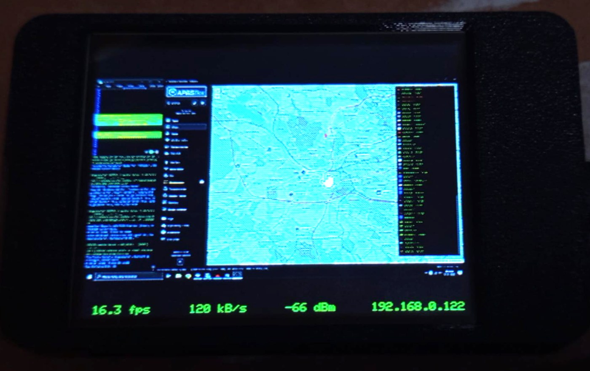
  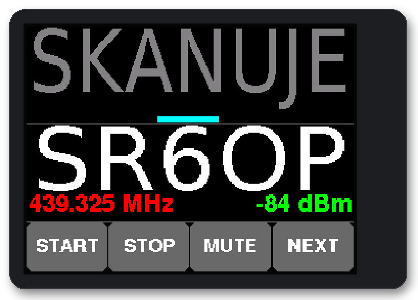
</p>
<p align="center"><sub>Left: photo of the panel mirroring the APRS station desktop. Right: the scanner page — an image
generated from the firmware's drawing code (the same fonts and constants as on the panel).</sub></p>

## What it does

| | |
|---|---|
| **Mirror / second monitor** | the Windows desktop (an existing screen or a Parsec VDD virtual monitor) on the panel over Wi-Fi, about 20–40 fps, with touch, panning and zoom |
| **SDR Oxide scanner page** | two radios (2 m and 70 cm): channel name, frequency, level; START / STOP / MUTE / NEXT; pops up by itself on a transmission |
| **Scanner web page** | both radios in a phone or PC browser: spectrum, waterfall, channels, controls and listening to the scanner |
| **Ulanzi D100H dial** | VFO tuning, radio select, scan, memory channels, filter width — while Oxide is in front; volume and media keys with any other window |

The panel is part of two systems, described at the end: the [APRS station](#part-of-the-sp9tkn-aprs-station) (it shows
the station screen) and the [SDR scanner](#part-of-the-sp9tkn-sdr-scanner) (it shows who is on the air).

## Quick start — ready-made files

1. Download the firmware image for your panel from **[Releases](https://github.com/SP9TKN/cyd-monitor/releases)** and write it **at address 0x0**:
   `python -m esptool --port COMx write_flash 0x0 <file>.bin`, or in the browser with
   [esptool-js](https://espressif.github.io/esptool-js/). **ILI9341** fits most boards; **ST7789** is for the newer
   "v3" boards (the symptom of the wrong one: inverted colours or a shifted picture).
2. The panel opens a Wi-Fi network **`CYD-Monitor-Setup`** — join it with a phone, open `http://192.168.4.1` and enter
   your 2.4 GHz Wi-Fi (leave the server IP empty).
3. On the PC run **`cyd-monitor.exe`** from Releases (no .NET installation needed). The first time, allow it on private
   networks in the Windows firewall. The panel finds the server by itself within a few seconds.

Step by step, with autostart, the virtual monitor and troubleshooting: **[docs/QUICKSTART.md](docs/QUICKSTART.md)**.

## How it works

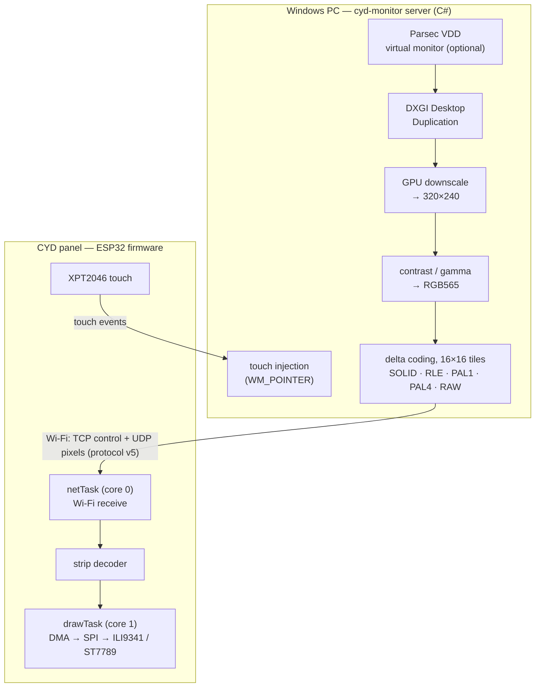

The panel works as a **second Windows monitor** — listed in the display settings, its picture sent over Wi-Fi, scaled
from a normal resolution down to 320×240, with working touch — or it shows an existing screen. Protocol
specification (in Polish): [docs/protocol-v5-udp.pl.md](docs/protocol-v5-udp.pl.md).

<p align="center">
  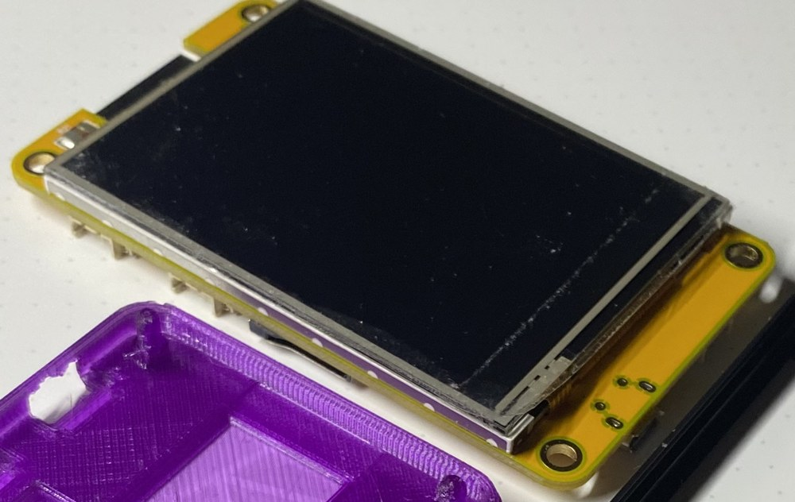
  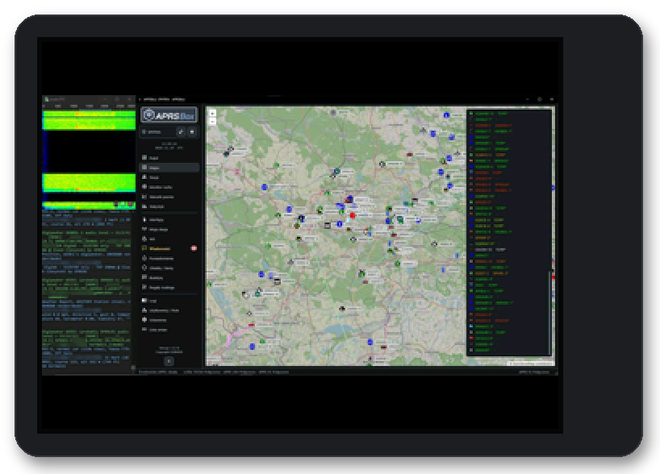
</p>
<p align="center"><sub>Left: the ESP32-2432S028R board (photo: the
<a href="https://github.com/witnessmenow/ESP32-Cheap-Yellow-Display">ESP32-Cheap-Yellow-Display</a> project, MIT).
Right: mirror simulation — a 1920×1080 desktop fitted into 320×240 and reduced to RGB565, the way the server does it.</sub></p>

## Why it is built this way

Three decisions came out of measurements, not assumptions. They are worth knowing, because they set the limits of what
this setup can do.

### Capture: DXGI, not GDI

The first version used GDI (`StretchBlt` from the screen DC). A measurement (`--benchcapture`) showed that **reading the
screen through GDI is synchronised with the monitor refresh**:

<picture>
  <source media="(prefers-color-scheme: dark)" srcset="docs/images/chart_capture_en_dark.png">
  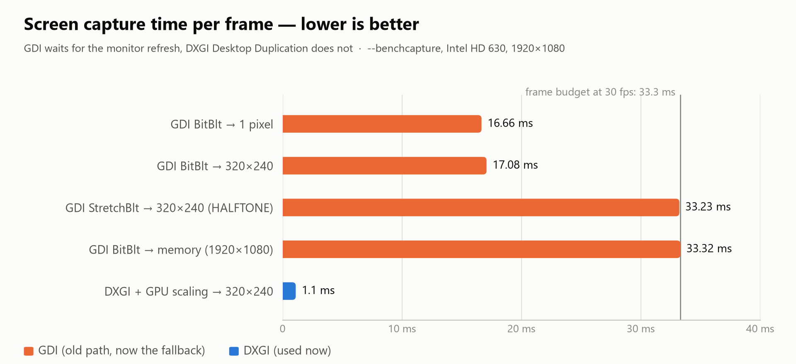
</picture>

```
BitBlt screen -> 1 pixel                   16.66 ms   <- exactly one vblank at 60 Hz
BitBlt screen -> 320x240                   17.08 ms
StretchBlt screen -> 320x240 (HALFTONE)    33.23 ms   <- two vblanks
BitBlt screen -> memory (1920x1080)        33.32 ms
```

The cost does not depend on the number of pixels — a one-pixel read costs as much as a quarter of the screen. This is
*waiting*, not work, so no stretch mode or intermediate buffer can shorten it. 33.3 ms is the whole frame budget at
30 fps, with no room left for conversion, encoding and the network.

DXGI Desktop Duplication has no such lock, hands over a ready texture on the GPU (so scaling is free) and returns only
the 320×240 result to system memory instead of the full 8 MB. After the change:

```
capture + scaling            1.10 ms
contrast/gamma/dithering     1.13 ms
delta coding                 0.41 ms
worst frame                 14.13 ms   (budget: 33.3 ms)
```

The GDI path stays as a fallback (`--gdi`), because Duplication is refused in some sessions. It then gives ~25–30 fps
with no headroom.

### Encoding: tiles and five modes

A raw 320×240 RGB565 frame is 153.6 kB. At 30 fps that is 37 Mbit/s — beyond the ESP32's Wi-Fi. So only changed 16×16
tiles are sent, joined into horizontal strips, and each strip is coded with whichever of five modes comes out shortest:
`SOLID`, `RLE`, `PAL1` (2 colours, bitmap), `PAL4` (≤16 colours, 4 bits/pixel) or `RAW`.

A desktop is mostly flat colour, so this works well — a full refresh drops from 150 kB to about 36 kB. Ordinary desktop
changes are ~1 kB per frame.

### Dithering off by default

This is a real trade-off, measured on a real desktop:

<picture>
  <source media="(prefers-color-scheme: dark)" srcset="docs/images/chart_dithering_en_dark.png">
  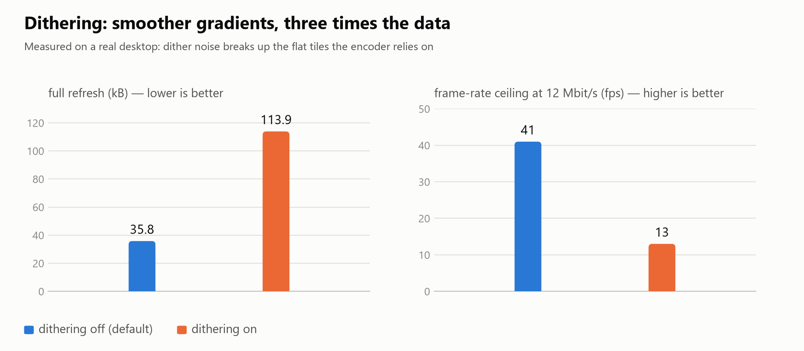
</picture>

| | full refresh | ceiling at 12 Mbit/s |
|---|---|---|
| dithering **off** (default) | 35.8 kB | **41 fps** |
| dithering **on** | 113.9 kB | 13 fps |

Dithering hides banding on gradients, but the noise it adds wrecks the compression — a tile stops being uniform.
A desktop has few gradients, so smoothness wins by default. It is switched on in the panel's settings page or with
the `--dither` flag.

## Running from source

### 1. Firmware

```powershell
powershell -ExecutionPolicy Bypass -File scripts\build-firmware.ps1
```

The script drives [arduino-cli](https://github.com/arduino/arduino-cli) from `tools\arduino-cli.exe` with a
configuration in `%LOCALAPPDATA%\cyd-arduino` (the compilers and SDKs are about 1.5 GB, shared by every sketch, so they
are kept out of the project folder). The port is detected automatically; `-CompileOnly` only compiles. For late "v3"
boards with an ST7789 instead of the ILI9341 (symptom: inverted colours) add `-St7789`. If the panel sparkles, lower the
clock: `-SpiHz 65000000`.

One-time setup (the versions the release was built with: ESP32 core 3.3.11, LovyanGFX 1.2.29, JPEGDEC 1.8.4):

```powershell
$d = "$env:LOCALAPPDATA\cyd-arduino"; $a = "tools\arduino-cli.exe"
& $a config init --dest-dir $d
& $a --config-file $d\arduino-cli.yaml config set directories.data "$d\data"
& $a --config-file $d\arduino-cli.yaml config set directories.downloads "$d\downloads"
& $a --config-file $d\arduino-cli.yaml config set directories.user "$d\user"
& $a --config-file $d\arduino-cli.yaml config add board_manager.additional_urls https://espressif.github.io/arduino-esp32/package_esp32_index.json
& $a --config-file $d\arduino-cli.yaml core update-index
& $a --config-file $d\arduino-cli.yaml core install esp32:esp32@3.3.11
& $a --config-file $d\arduino-cli.yaml lib install LovyanGFX@1.2.29 JPEGDEC@1.8.4
```

### 2. Wi-Fi on the panel

On first start the CYD opens a network **`CYD-Monitor-Setup`**. Join it and open `http://192.168.4.1` — the form takes
the SSID, the password and optionally the server IP. An empty IP means automatic discovery (the panel calls out by UDP
broadcast, the server answers).

The settings are stored in NVS. To configure again: hold **BOOT** for a second while the panel cannot connect to the
network (or use "Reset network" on the panel's settings page).

### 3. Virtual monitor driver (optional, once, as administrator)

```powershell
powershell -ExecutionPolicy Bypass -File scripts\install-virtual-display.ps1
```

Installs [Parsec VDD](https://github.com/nomi-san/parsec-vdd) — a signed driver under the MIT licence. The script
checks the Authenticode signature before running anything and stops if it is not valid.

The GUI application that comes with it is not needed for anything: the server talks to the driver directly through
IOCTL. **The virtual monitor exists only while the server runs** — the driver removes the display about a second after
the last keep-alive, so a server crash does not leave the desktop stretched over a screen that no longer exists.

### 4. Server

Needs the [.NET 10 SDK](https://dotnet.microsoft.com/download) (the `cyd-monitor.exe` from Releases carries .NET
inside).

```powershell
dotnet run --project server\cyd-monitor -- --virtual
```

Without the driver, an existing screen can be shown right away:

```powershell
dotnet run --project server\cyd-monitor -- --monitor 1
```

### 5. Server in the background and autostart

The server does not have to be a window somebody watches. The simplest way: **`scripts\enable-service.cmd`** — starts
the server now and registers the autostart (`disable-service.cmd` undoes it). The single steps (each with a `.cmd` to
click):

| File | What it does |
|---|---|
| `start-cyd` / `stop-cyd` | starts / stops the server itself (hidden, independent of any window) |
| `start-cyd-watchdog` / `stop-cyd-watchdog` | turns on / off the "CYD-Watchdog" task: at logon and then every 30 s it checks that the server runs and starts it if not |

The watchdog is turned on once (`start-cyd-watchdog`); from then on the server comes up by itself after every restart.
With the watchdog on, `stop-cyd` is undone within about 30 s — to stop for good, run `stop-cyd-watchdog` first. Before
rebuilding the server (`dotnet build`) stop it with `stop-cyd`: Windows will not overwrite a running exe.

The server is started through WMI rather than as a child of a window or a task, so it does not die with them. Watchdog
log: `%LOCALAPPDATA%\cyd-monitor\cyd-watchdog.log`.

## Panel settings (the panel's own web page)

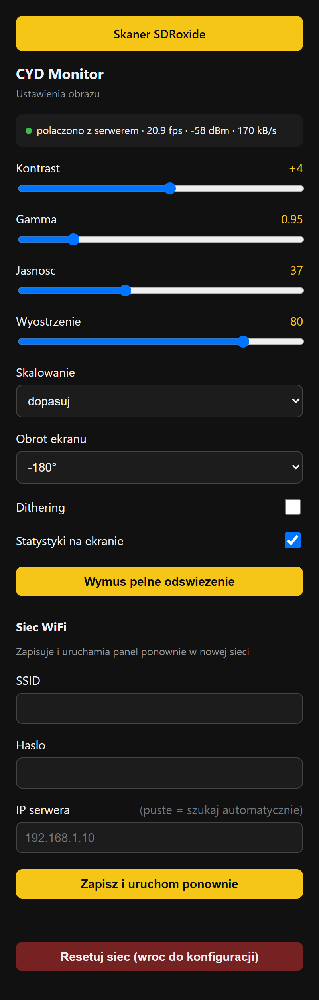

All picture settings live on the page **`http://<panel IP>`** (the panel shows its IP at start and in the stats line).
The earlier on-panel menu has been removed: touches on the panel are meant for Windows, and a page on the phone is more
comfortable.

| Item | Where it acts | Notes |
|---|---|---|
| Contrast | server (LUT) | the ILI9341 has no contrast register |
| Gamma | server (LUT) | 1.00 = unchanged |
| Brightness | panel (backlight PWM) | in hardware, no colour loss |
| Sharpening | server | unsharp mask after scaling |
| Scaling | server | fit / stretch / 1:1 (follows the cursor) |
| Rotation | panel | ±180° |
| Dithering | server | see the chart above |
| On-screen stats | panel | fps, kB/s, RSSI, IP |
| Flip scanner touch | panel | when the bottom buttons react to a touch at the top |
| Wi-Fi network | panel | save and restart on a new network, reset to setup |

Server-side settings show only after the server confirms them (`MSG_OPTACK`), so the page never displays a value that
did not take effect. At the very top a **Skaner SDRoxide** button opens the scanner web page.

<br clear="right"/>

## Gestures on the panel

| Gesture | What it does |
|---|---|
| drag | pans the view (mirror) |
| hold 0.7 s without moving | zoom 1× → 2× → 4× (mirror) |
| double tap | switches between the mirror and the scanner; on the scanner, outside the button bar |
| tap on a radio's block | turns that radio's sound on or off, after about 0.4 s (scanner) |

## SDR Oxide scanner

<p align="center">
  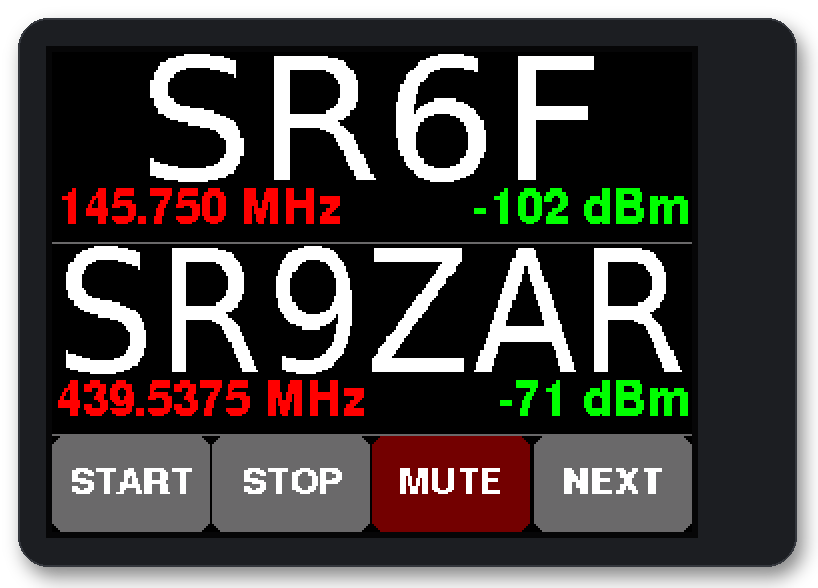
  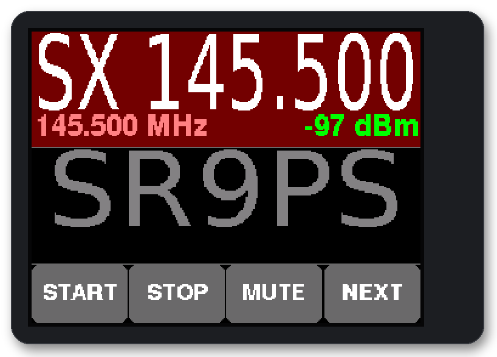
  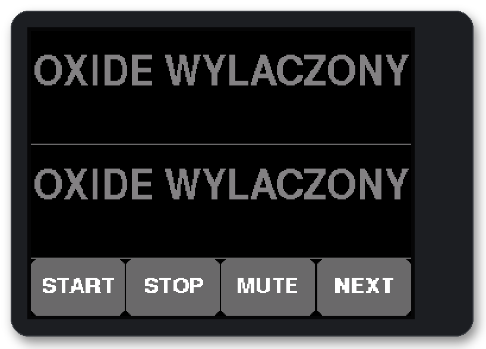
</p>
<p align="center"><sub>Simulations from the firmware code: two transmissions at once with the sound card muted (MUTE) · the 2 m
radio with its sound off (dark red block), 70 cm stopped on a channel · SDR Oxide closed. The panel texts are Polish:
SKANUJE = scanning, OXIDE WYLACZONY = Oxide is off.</sub></p>

The scanner page replaces the mirror on the whole screen: two blocks, one per radio (channel name, frequency, level),
and under them a shared bar of START, STOP, MUTE, NEXT. A radio with nobody on the air shows `SKANUJE` (scanning) with
a moving bar; a scanner that is switched off shows the current memory channel — outside the memories just the frequency
instead of a name — in grey. A double tap opens the page, or a transmission does: the panel pops out of the mirror and
returns to it a second after the transmission ends. A double tap on a page that popped up by itself closes it until
the end of that transmission. A page opened with a double tap stays until you close it. While the scanner page is
open, the server pauses screen capture.

The data comes through SDR Oxide's built-in Hamlib rigctld servers: **4532** for SDR 2M and **4533** for SDR 70CM, both
on 127.0.0.1, with transmit disabled (Settings → Servers, separately for each radio). Without them the page shows
`OXIDE WYLACZONY`, and a radio switched off in Oxide's radio list (`radios.json`, `enabled: false`; that is how the
single-receiver variant scanning both bands looks) shows `RADIO WYLACZONE` and has no card on the web page. The server
connects for a question and disconnects at once: Oxide serves every open connection with a thread spinning on the
socket, a whole core per connection.

Some commands need patches from the [SP9TKN build of SDR Oxide](https://github.com/SP9TKN/sdroxide-brown)
(`latka_skan.py`, `latka_pamiec.py`, `latka_pomin.py`, `latka_sluch.py`, `latka_www.py`); without them the server falls
back to pressing Oxide's buttons through Windows UI Automation or hides the feature.

- **Stopped:** the frequency stays for at least 0.4 s, since the scan hops about every 150 ms.
- **Transmission:** stopped plus a level above the squelch from that radio's `modeprofiles.json`, converted with
  `cal_offset_db` from `config.toml`. Standing still is not enough, because a switched-off scanner stands still too.
- **Name:** from `memories.json`, first from the folders this radio scans (`scanner.json`). Polish letters lose their
  diacritics, because the panel fonts are ASCII.
- **Starting and closing Oxide:** START with the program closed starts it (no console window; output goes to
  `oxide.log` in the server's data folder; the program is `D:\oxide-build\bin\sdroxide.exe` (the author's build) when
  present, otherwise `..\oxide\sdroxide.exe` next to the server folder, as in the portable package, and finally the
  Program Files install), and the next START turns scanning on. STOP stops scanning, and another STOP, with both
  scanners already off, closes the program with an ordinary window close. The second STOP counts only after a second,
  so a twitch of the touch cannot close the program.
- **Closing a minimised Oxide:** the program then saves its window with position -32000 and size 0, and crashes at
  every start after that (`min > max` in `oxide.log`). The server restores the window before closing it, and when Oxide
  is not running it fixes the `window` entry in `%APPDATA%\sdroxide\data\app.ron` itself (backup: `app.ron.bak-okno`).
- **START, STOP, NEXT:** act on both radios, NEXT only on the one that has stopped. NEXT on a stopped scanner (a clicked
  channel, a typed frequency) starts it and moves on at once, so START is not needed first. Oxide with `latka_skan.py`
  receives them through rigctld: `g MEM 0` (start), `g STOP 0`, `g NEXT 0`, and the state is read with `u SCAN`; there
  is deliberately no SKIP. Oxide Brown rebuilds its scanner window on every hop, so a NEXT clicked through UIA vanished
  before it could be pressed. Without the patch the server presses the buttons through Windows UI Automation
  (`OxideUi.cs`). The `Scanner` window does not have to be open: the server expands it or opens it for a split second
  and restores the previous state, and a minimised Oxide comes back for that moment without taking the focus.
- **RAM with Oxide minimised:** the window keeps its whole picture in memory (about 400 MB of graphics). After each
  minimise the server empties Oxide's working set once (`EmptyWorkingSet`): what reception uses comes back at once,
  the window graphics only when it is opened. The program's committed memory does not change; RAM is freed for other
  programs (measured: 658 → 76 MB in Task Manager, no samples lost).
- **Split view ⊞:** a radio without a pane has no buttons, and Oxide does not remember this view after a restart. The
  server checks it every 5 s and, once per Oxide start, about 8 s after it, presses ⊞ on the hidden radio and then
  minimises Oxide without taking the focus, so the APRS station stays on the desktop. It minimises only after the panel
  has been switched on, so a server restart does not hide the window. A pane closed by hand stays closed until a button
  on the CYD needs it.
- **MUTE:** mutes the sound card Oxide plays through (`audio_output` in `config.toml`), the same as the speaker icon in
  Windows. A dark red button means muted. An empty or unknown card name means the Windows default card, as in Oxide
  itself.
- **Touch on the scanner page:** the first panel reports the Y coordinate upside down, so the scanner page flips it.
  Not every unit does, so it is a panel setting: "Flip scanner touch" on its web page (`/api/set key=scanflip`, in NVS as
  `sfy`, on by default). The mirror uses only the movement of a finger, so it is not affected.
- **Sound of one radio:** a tap on its block toggles that radio's MUTE in Oxide (`U MUTE` over Hamlib), and a dark red
  block background means its sound is off. A muted radio still opens the page on a transmission.

Tests without a panel, from the server folder:

```
cyd-monitor --skaner-test 30          # what the panel would get with the page open
cyd-monitor --skaner-okno 60          # when the page would pop up
cyd-monitor --skaner-klik 1 stop      # presses a button: radio 0|1, start|stop|next [Hz]
cyd-monitor --skaner-minimalizuj      # minimises Oxide
cyd-monitor --skaner-napraw app.ron   # fixes the window entry in the given state file
```

On the panel, `POST /api/set` with `key=scan&value=1` (or `0`) opens and closes the page, and `/api/state` reports
`scan` and the last touch in `touchX`, `touchY`.

## Ulanzi D100H dial

<p align="center">
  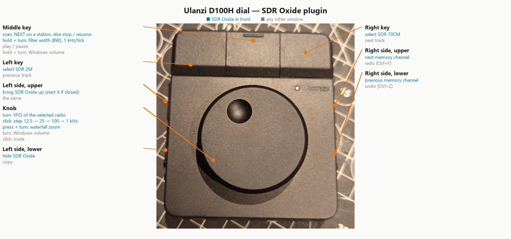
</p>

The dial controls SDR Oxide through a plugin in Ulanzi Studio ([`ulanzi-plugin/`](ulanzi-plugin/README.md)) and this
server's `DialBridge.cs` module. The plugin has no logic of its own: it sends every event as a `GET` to
`127.0.0.1:7792`. The server checks on every event whether Oxide is in front.

| Control | Oxide in front | Any other window |
|---|---|---|
| Left key above the knob | selects SDR 2M | previous track |
| Middle key above the knob, short | scan stopped on a station: NEXT; otherwise stops/resumes the selected radio's scan | play/pause |
| Middle key held and the knob turned | filter width (BW) of the selected radio, 1 kHz per tick | Windows volume |
| Right key above the knob | selects SDR 70CM | next track |
| Knob | VFO of the selected radio | Windows volume |
| Single click of the knob | changes the step: 12.5 → 25 → 100 → 1 kHz | Windows mute |
| Knob pressed and turned | waterfall zoom of the selected radio | Windows volume |
| Left side, upper | brings Oxide up (starts it if not running) | the same |
| Left side, lower | hides Oxide, the window below comes back | Copy |
| Right side, upper | next memory channel (up the list) of the selected radio | Redo (Ctrl+Y) |
| Right side, lower | previous memory channel (down the list) of the selected radio | Undo (Ctrl+Z) |

- **Selecting a radio** is also the accent frame of the tab in Oxide. The tab text has no UIA action, so it is a click
  posted to the window (`PostMessage`): it moves neither the cursor nor the focus. The server remembers the choice until
  a restart, then goes back to 2 m.
- **Memory channels:** the list is the folders ticked in this radio's scanner (nothing ticked: all channels), in the
  saved order, including channels on SKIP, and after the end it wraps to the start. The recall goes through `E <number>`
  in rigctld, which plain Oxide does not have (patch `latka_pamiec.py` in the
  [SP9TKN build](https://github.com/SP9TKN/sdroxide-brown)), and not through `F`, because a channel also carries the
  filter, the offset and the tone. A recall ends the scan on that radio, and the middle key resumes it.
- **The knob goes through rigctld** (`F`). `F` ends the scan only on that radio, so a turn stops the scan and the middle
  key resumes it. Tuning lands on a multiple of the step, like tuning in Oxide itself. The step is shared by both radios
  and shown nowhere: it shows in the digits at the next turn. After a server restart it is back to 12.5 kHz.
- **Zoom** is a mouse wheel posted to the window (`PostMessage`) over the middle of the pane's waterfall, one notch per
  tick. It works when the real cursor is over the Oxide window, which is the case with the window maximised in front.
  Otherwise Windows reports the cursor outside the window and the wheel is lost.
- **Filter width:** rigctld accepts a passband in `M`, answers `RPRT 0` and changes nothing, and TCI has no filter. So
  `ulanzi-plugin\set-oxide-filter-keys.py` binds F13/F14 to the `FilterWidth` action in Oxide's `input.json`, and the
  server presses those keys. The shortcut goes to the pane with the accent frame, so the server sets that first. The
  middle key acts on release: whether it was turned is decided by the plugin, because only there do the events still
  arrive in order. The scanner applies the filter stored in the memory when it stops on a channel, so such a change
  lasts until the next channel.
- **Why not a separate preset for sdroxide.exe:** Studio 3.4.8 hangs for good when switching to such a preset, and with
  "Preset Switch Reminder" off it does not switch to it at all. Checked 2026-10-31.
- **Foreground:** Windows hands it only to the process that saw the last input, so the server first sends an empty mouse
  event (`SendInput`) and then `SetForegroundWindow`.
- **Needs:** Ulanzi Studio running (autostart) and this server. Without the server, the buttons and the knob on this
  preset do nothing, the Windows volume included.
- **After sleep:** a dial woken after a long break can fail its authentication (`HidDeviceAuth failed` in the Studio
  log), and Studio then waits for the next wake-up with no button working. `cyd-watchdog.ps1` reads the end of the
  Studio log every 5 s and restarts Studio in that state; it also starts Studio when it is not running. Trace in
  `cyd-watchdog.log`.

Installation: [ulanzi-plugin/README.md](ulanzi-plugin/README.md). Test without the dial:
`curl http://127.0.0.1:7792/vol/1`, as well as `/tune/1`, `/hold/1`, `/filter/1`, `/radio/1`, `/scan`, `/show`, `/hide`,
`/press`.

## Scanner web page

<p align="center">
  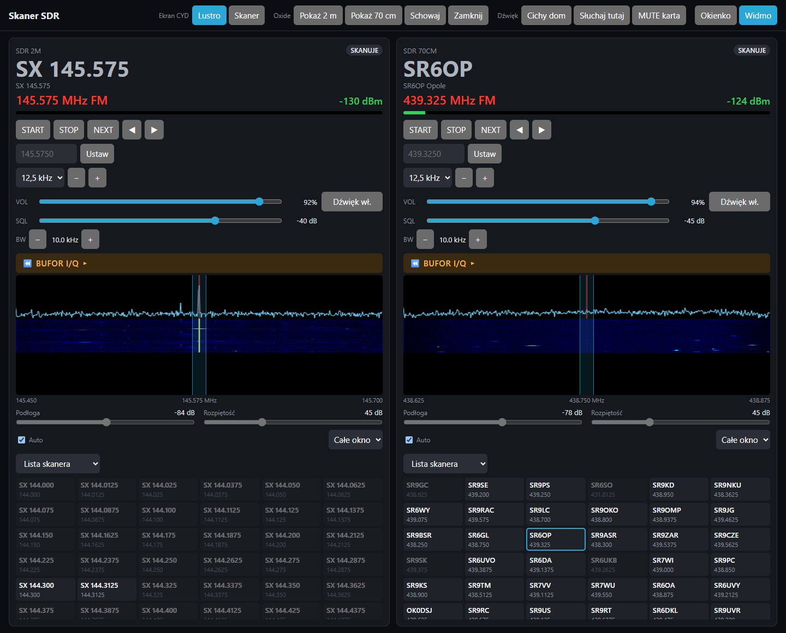
  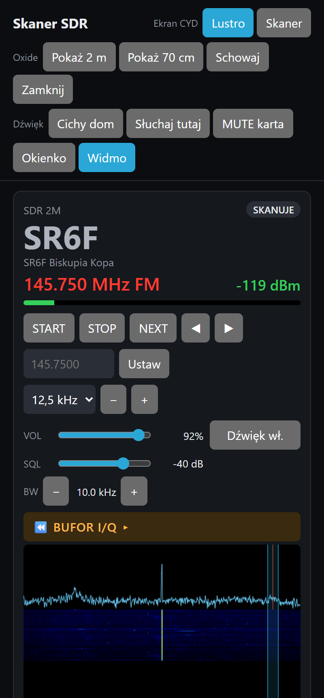
</p>
<p align="center"><sub>The scanner web page on a PC and on a phone (real screenshots; the channels are public repeaters
and simplex channels).</sub></p>

The server on the PC serves the page `http://<PC IP>:7793/`; the panel's page has a `Skaner SDRoxide` button to it at
the very top. It shows both radios: state, channel, frequency, level, spectrum with waterfall, and the channel list
with the current one marked. It controls the scanner (START, STOP, NEXT for each radio separately), channels, frequency
(typed in or stepped), volume and the radio's sound, squelch, BW, the sound card mute, the CYD screen (mirror or
scanner) and the Oxide window. The spectrum floor, span and width are remembered in the browser and change nothing in
Oxide. There is no transmitting there.

A click on a channel in the list adds it to the memory scan or takes it out (greyed = skipped) and tunes the radio to
it, which ends the scan on that radio. Oxide itself makes the change (`g EXCL <id>` / `g INCL <id>` in rigctld,
`latka_pomin.py`), so it lands in `scanner.json` and in Oxide's scanner window. On the spectrum a translucent band shows
the filter width (BW), and a red line the radio's frequency.

**Sound on the page:** three independent switches, each doing only its own thing. `Słuchaj tutaj` (listen here) plays
both radios mixed in the browser, so a phone keeps playing in the background and with the screen off, with a tile on
the lock screen (Media Session). `Cichy dom` (quiet home) mutes only Oxide in the Windows volume mixer (its sessions on
the `audio_output` card), so the scanner is not heard at home while the PC's other sounds play. `MUTE karta` mutes the
whole card. The `Okienko` (small window) button turns on a floating window with both radios (name, frequency, level;
a canvas video carrying the scanner audio) that appears only once the browser is minimised and hides on return. A phone
(Chrome on Android) makes a floating window only from a video that is fullscreen at the moment of leaving, and a page
cannot go fullscreen on its way to the background. So the button switches the whole page to fullscreen (with
`navigationUI: 'show'`, so Android's navigation bar stays, the status and address bars go), looking as usual, with the
video lying under it, invisible, fullscreen (class `czeka`): the browser treats it as a fullscreen video. Home shrinks
the page to the floating window, and the `@media (max-height:320px)` style then shows the video instead of the page.
Leaving fullscreen (the back gesture) or a second tap on the button turns the mode off. A PC opens the floating window
through the Picture-in-Picture API at once; returning to the tab closes it and turns the mode off. The sound comes from
a Web Audio queue (about 0.3 s delay) through the media player, so it also plays in the background. The audio comes
from TCI (`/api/dzwiek`, 16 kHz, mono, 16 bits, about 32 kB/s) and bypasses the sound card. Plain TCI gives the audio
before the squelch, for decoders, so the server asks Oxide with `latka_sluch.py` for `audio_heard:true;`: what the
squelch let through, digital voice included. The echo of that command tells the server the request worked. Without the
echo — Oxide without the patch — it opens on the signal level, one reading late. Either way the audio is from before
the radio's volume and mute, so the server applies those two. Closing the page switches nothing back on: `Cichy dom`
and `MUTE karta` stay as they were left.

SQL and BW need Oxide with `latka_www.py` (`l SQL`, `L SQL`, `M <mode> <width>` in rigctld); without it these two rows
are hidden. The squelch works like the slider in Oxide, separately for the mode the radio is in. BW steps through 1, 5,
7, 10, 12.5, 15, 25, 100 kHz. Oxide with `latka_bw25.py` allows up to 48 kHz in FM (edges up to 24 kHz from the
carrier), without it FM is cut at 24 kHz; 100 kHz fully works in WFM. BW lasts until the scanner's next stop, because
the channel restores its filter.

- **Data:** state over rigctld (`ScannerWeb.cs`), spectrum from the I/Q of Oxide's TCI servers: **50001** SDR 2M and
  **50002** SDR 70CM, both on 127.0.0.1. For the second radio TCI has to be enabled in `radio-1\tciserver.json` (or
  Settings → Servers of that radio).
- **Cost:** rigctld and I/Q are read only while the page is open and visible. The `Widmo` (spectrum) button turns I/Q off
  when the page is used over a slow link. Oxide needs the TCI fix (`set_nonblocking(false)` in `server/client.rs`);
  without it every TCI connection takes a core.
- **Access:** no password, like the panel's page, so only for the local network and Tailscale. Commands from another
  site are refused (`Origin` header). **Do not forward the port on your router.**
- **While scanning** the spectrum jumps with the radio, because at a low sample rate nearly every channel is a
  different window; the picture is stable when the radio stops.

Test next to a running server: `cyd-monitor --skaner-www 60`.

## How many frames, really

Measured on a PC with Intel HD 630, 1920×1080:

* **server**: 3.5 ms per frame on average, 14 ms worst case — well within 33.3 ms;
* **link**: ordinary desktop changes are ~1 kB/frame, i.e. 0.3 Mbit/s at 30 fps — the link is not the limit here;
* **full refresh** (switching a window to fullscreen) is 35.8 kB, i.e. 20 fps at 6 Mbit/s, 41 fps at 12 Mbit/s;
* **panel**: a full frame over SPI at 80 MHz takes 15.4 ms. That is why the firmware has two tasks on two cores —
  network and SPI overlap instead of adding up.

**What it will not do:** photographic content full screen (a film, a slide show) has no flat areas, so it falls back to
`RAW`, and there only the Wi-Fi decides the frame rate. Lossy coding would fix that, at the cost of a JPEG decoder on
the ESP32 that eats more milliseconds than it saves.

## A cable is not enough

The CYD has a classic ESP32-WROOM without native USB — the port is a CH340 bridge, i.e. a UART. At 2 Mbaud that gives
about 200 kB/s, and a single RGB565 frame is 153 kB. So the picture goes over Wi-Fi, and the cable is only for flashing
the firmware and for diagnostics on the serial console.

## Diagnostics

```powershell
dotnet run --project server\cyd-monitor -- --list          # monitors and 4:3 modes
dotnet run --project server\cyd-monitor -- --selftest 60   # check the codec, measure motion
dotnet run --project server\cyd-monitor -- --benchcapture  # compare the capture paths
```

`--selftest` encodes real frames from the desktop and plays them back with an **independent decoder implementation**
(`SelfTest.Decode`), deliberately separate code from the firmware's `decodeStrip()` — the point is to catch a mismatch
between two implementations of the same specification. It was this test that found a wrongly computed strip header size
(11 instead of 13 bytes) before anything reached the hardware.

### Common problems

**The panel does not find the server.** Discovery works by UDP broadcast on port 7787 — the Windows firewall has to
let `cyd-monitor` through. Workaround: enter the server IP in the setup portal. A router's "guest" network often blocks
devices from each other.

**Unknown USB device / code 43 when flashing.** This is not a missing driver — Windows could not read the descriptors,
so no driver has anything to attach to. The `ch341ser.inf`, `ch343ser.inf` and `silabser.inf` drivers are in the
Windows store and attach by themselves. The cause is physical: a cable without data lines, a loose micro-USB socket or
a hub.

**The panel sparkles or shows wrong pixels.** The SPI clock is too high for that unit — rebuild with `-SpiHz 65000000`.

## Credits

* [nomi-san/parsec-vdd](https://github.com/nomi-san/parsec-vdd) — the virtual monitor driver (MIT) and its IOCTL
  interface, on which `VirtualDisplay.cs` is based.
* [witnessmenow/ESP32-Cheap-Yellow-Display](https://github.com/witnessmenow/ESP32-Cheap-Yellow-Display) — the board's
  pinout; it confirmed the configuration in `lgfx_cyd.h`. The board photo also comes from that repository (MIT).
* [LovyanGFX](https://github.com/lovyan03/LovyanGFX) — the panel driver. Chosen over TFT_eSPI because on this board the
  panel and the touch sit on **two different SPI buses** (panel 14/13/12, XPT2046 25/32/39/33). TFT_eSPI assumes a
  shared bus, so it would need a second library and manual bus arbitration; LovyanGFX takes a separate `spi_host` per
  device and has DMA (`pushImageDMA`), without which 30 fps would be out of reach.
* [Vortice.Windows](https://github.com/amerkoleci/Vortice.Windows) (MIT) — Direct3D 11 / DXGI for C#.
* Similar projects showing other approaches: [S3-tinyTV](https://github.com/RYUKIUN/S3-tinyTV) (JPEG tiles over UDP
  on an ESP32-S3) and [ESP32-Screen-Mirroring](https://github.com/aayushchouhan24/ESP32-Screen-Mirroring).
* The panel screen images in this README are simulations generated from the firmware's drawing code (`scanDrawRadio`,
  `scanDrawButton`) with the same LovyanGFX fonts; the photos of the panel and the dial are the author's.

<!-- ecosystem:aprs:start -->

## Part of the SP9TKN APRS station

Five projects work together as one APRS station on a Windows PC with a Yaesu FT-290R II (2 m). Each part does one job and also works on its own.

| Project | Role |
|---|---|
| [ESP32 PTT trigger](https://github.com/SP9TKN/esp32-ptt-pc818) | keys the radio's PTT through a PC818 optocoupler (galvanic isolation), red/green TX/RX LEDs |
| [Audio PTT](https://github.com/SP9TKN/audio-ptt) | radio audio as a UZ7HO-style waterfall + PTT lamps, read-only |
| [APRSBox for Windows](https://github.com/SP9TKN/APRSBox) | the APRS application: iGate, digipeater, beacons, messages, map (Windows port of SQ9MDD's APRSBox) |
| [CYD-Monitor](https://github.com/SP9TKN/cyd-monitor) **← you are here** | 2.8" ESP32 display as a wireless monitor: the station screen over Wi-Fi, with touch |
| [Direwolf — SP9TKN package](https://github.com/SP9TKN/direwolf) | sound-card modem / TNC (AFSK 1200): WB2OSZ's Direwolf 1.8.1 with a dark console window and the station configuration (PTT on DTR, KISS TCP for APRSBox) |

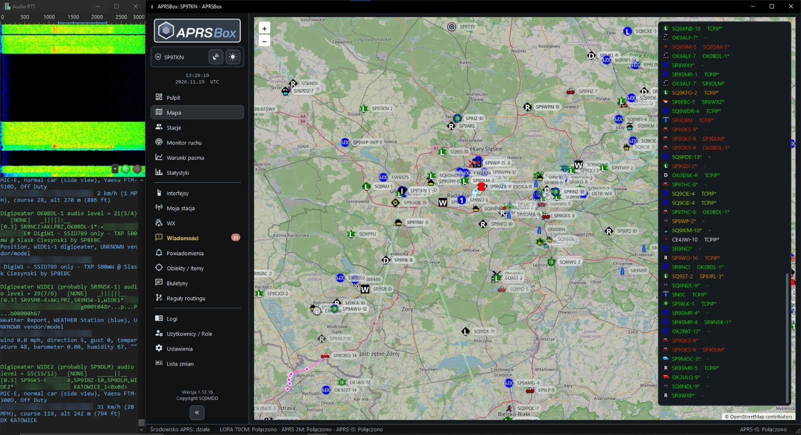
*The station at work: Audio PTT (top left), Direwolf (bottom left) and APRSBox with the map. Coordinates of other stations in the Direwolf window are blurred.*

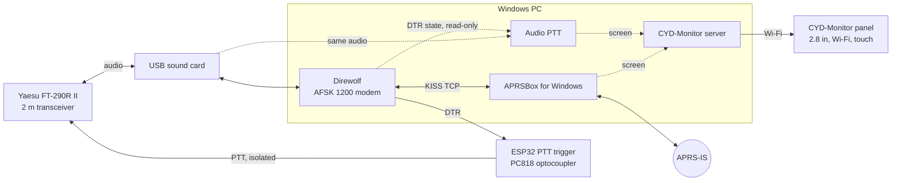

**How it works**

1. **Receive.** Audio from the FT-290R II goes through a USB sound card to **Direwolf**, which decodes the AFSK 1200
   packets and hands them to **APRSBox** over KISS TCP. APRSBox stores them, draws them on the map, gates them to
   APRS-IS and digipeats them according to its routing rules.
2. **Transmit.** APRSBox queues a beacon, a message or a frame to digipeat and passes it to Direwolf over KISS.
   Direwolf raises **DTR** on the USB serial port of the **ESP32 PTT trigger** (`PTT COMx DTR`); the board closes the
   radio's PTT through the PC818 optocoupler and lights the red LED, and Direwolf plays the packet audio.
3. **Watch.** **Audio PTT** shows the same radio audio as a waterfall, with two lamps that follow the PTT line. It
   reads the DTR state from the port Direwolf holds, without opening the port, so it never gets in the way of
   transmitting.
4. **From any room.** **CYD-Monitor** mirrors the station desktop (APRSBox map, Audio PTT, Direwolf log) to a 2.8"
   ESP32 "Cheap Yellow Display" over Wi-Fi. The same panel is also the display of the
   [SP9TKN SDR scanner](https://github.com/SP9TKN/cyd-monitor#part-of-the-sp9tkn-sdr-scanner): it jumps to the scanner page when SDR Oxide hears something.
5. **Unattended.** Watchdog scripts (in the APRSBox repository) restart any program that stops and put the windows
   back in place after the monitor sleeps; a virtual display keeps the desktop at 1920×1080 while the physical
   monitor is off.

<!-- ecosystem:aprs:end -->

<!-- ecosystem:sdr:start -->

## Part of the SP9TKN SDR scanner

SDR Oxide, CYD-Monitor and an Ulanzi dial work together as one two-band scanner: SDR Oxide listens, the CYD panel and a web page show what it hears, and the dial controls it like the knob of a radio.

| Project | Role |
|---|---|
| [SDR Oxide — SP9TKN build](https://github.com/SP9TKN/sdroxide-brown) | the receiver: two SDRs (2 m and 70 cm) scanning memory channels; the patches add scanner control over rigctld and the audio after squelch over TCI |
| [CYD-Monitor](https://github.com/SP9TKN/cyd-monitor) — server **← you are here** | reads SDR Oxide and drives the panel, the web page and the dial |
| [CYD-Monitor](https://github.com/SP9TKN/cyd-monitor) — panel **← you are here** | ESP32 "Cheap Yellow Display": scanner page with START / STOP / MUTE / NEXT, pops up on a transmission |
| [Ulanzi plugin](https://github.com/SP9TKN/cyd-monitor/tree/main/ulanzi-plugin) | Ulanzi Studio plugin for the D100H dial: tuning, radio select, scan, memories, filter width, zoom |


*The scanner's web page served by the CYD-Monitor server: both SDR Oxide radios with spectrum, waterfall and the channel list.*

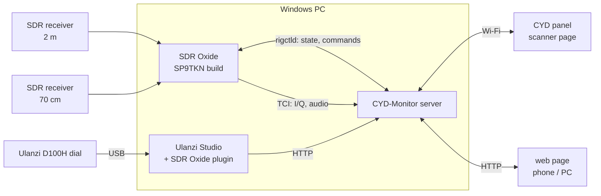

**How it works**

1. **SDR Oxide** runs two receivers, *SDR 2M* and *SDR 70CM*, each scanning its own memory channels. Each radio has a
   built-in Hamlib **rigctld** server and a **TCI** server on localhost. The SP9TKN patches add what a remote scanner
   needs: start / stop / next, memory recall, skipping channels, squelch and filter width over rigctld, and the audio
   after squelch over TCI.
2. The **CYD-Monitor server** asks rigctld several times a second for the frequency and the level. A frequency that
   stays put with the level above squelch is a transmission: the **CYD panel** jumps from the desktop mirror to the
   scanner page (channel name from SDR Oxide's memories, frequency, level) and returns a second after it ends.
   START, STOP, MUTE and NEXT on the panel go back to SDR Oxide.
3. The same server serves a **web page** for a phone or a PC on the home network: both radios with spectrum and
   waterfall from the TCI I/Q stream, the channel list, scanner controls and the scanner audio in the browser, also
   in the background on Android.
4. The **Ulanzi D100H dial** sends every button and knob event through the plugin as an HTTP request to the server.
   With SDR Oxide in front, the knob tunes the selected radio and the buttons pick the radio, start and stop the
   scan, step through the memories and change the filter width; with any other window in front, the same controls
   are media keys and the Windows volume.
5. The CYD panel is shared with the [SP9TKN APRS station](https://github.com/SP9TKN/cyd-monitor#part-of-the-sp9tkn-aprs-station):
   it shows the station screen until the scanner hears something.

<!-- ecosystem:sdr:end -->

## License

[GPL-3.0](LICENSE) © 2026 SP9TKN.

**Tools:** developed with [Claude Code](https://claude.com/claude-code) (Anthropic) — AI assistant used for coding,
testing and documentation.
