# CYD-Monitor

> 🇬🇧 English version: [README.md](README.md)

<!-- ecosystem-link:aprs -->
📡 Część **stacji APRS SP9TKN** — zobacz, [jak elementy działają razem](#część-stacji-aprs-sp9tkn).

<!-- ecosystem-link:sdr -->
📻 Część **skanera SDR SP9TKN** — zobacz, [jak elementy działają razem](#część-skanera-sdr-sp9tkn).

**Panel ESP32-2432S028R („Cheap Yellow Display”, 2,8") jako bezprzewodowy monitor Windows i pilot skanera SDR Oxide.**
Obraz pulpitu idzie przez WiFi, przeskalowany z pełnej rozdzielczości na 320×240, z działającym dotykiem. Gdy
SDR Oxide coś usłyszy, panel sam przeskakuje na stronę skanera. Ten sam serwer wystawia stronę www skanera
dla telefonu i obsługuje pokrętło Ulanzi D100H.

<p align="center">
  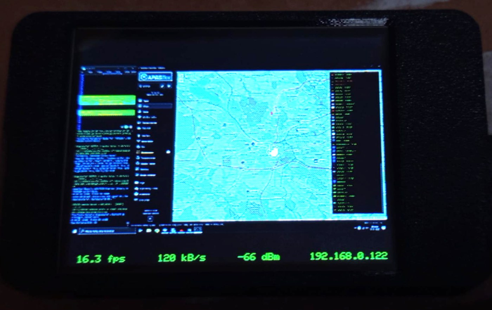
  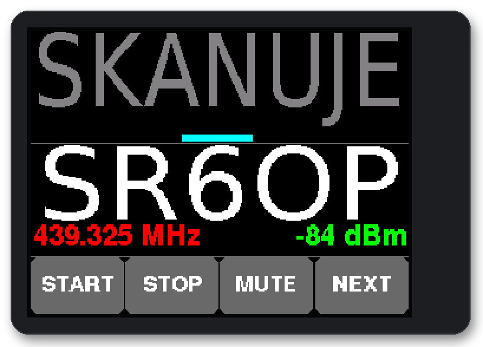
</p>
<p align="center"><sub>Z lewej: zdjęcie panelu z lustrem pulpitu stacji APRS. Z prawej: strona skanera — obraz wygenerowany
z kodu rysującego firmware (te same czcionki i stałe co na panelu).</sub></p>

## Co to robi

| | |
|---|---|
| **Lustro / drugi monitor** | pulpit Windows (istniejący ekran albo wirtualny monitor Parsec VDD) na panelu przez WiFi, ok. 20–40 fps, z dotykiem, przesuwaniem i powiększaniem |
| **Strona skanera SDR Oxide** | dwa radia (2 m i 70 cm): nazwa kanału, częstotliwość, poziom; START / STOP / MUTE / NEXT; wyskakuje sama przy transmisji |
| **Strona www skanera** | oba radia w przeglądarce telefonu albo komputera: widmo, wodospad, kanały, sterowanie i słuchanie skanera |
| **Pokrętło Ulanzi D100H** | strojenie VFO, wybór radia, skan, kanały pamięci, szerokość filtra — gdy Oxide jest na wierzchu; przy innych oknach głośność i multimedia |

Panel jest częścią dwóch zestawów, opisanych na końcu: [stacji APRS](#część-stacji-aprs-sp9tkn) (pokazuje jej
ekran) i [skanera SDR](#część-skanera-sdr-sp9tkn) (pokazuje, kto nadaje).

## Najszybszy start — gotowe pliki

1. Pobierz z **[Releases](https://github.com/SP9TKN/cyd-monitor/releases)** obraz firmware dla swojego panelu i wgraj od adresu **0x0**:
   `python -m esptool --port COMx write_flash 0x0 <plik>.bin` albo przez [esptool-js](https://espressif.github.io/esptool-js/)
   w przeglądarce. **ILI9341** to większość płytek; **ST7789** to nowsze „v3” (objaw złego wyboru: odwrócone kolory
   albo przesunięty obraz).
2. Panel wystawia sieć **`CYD-Monitor-Setup`** — połącz się telefonem, otwórz `http://192.168.4.1`, wpisz swoją sieć
   WiFi 2,4 GHz (pole IP serwera zostaw puste).
3. Na komputerze uruchom **`cyd-monitor.exe`** z Releases (nie wymaga instalowania .NET). Za pierwszym razem pozwól
   mu na dostęp do sieci prywatnej w zaporze Windows. Panel znajdzie serwer sam w kilka sekund.

Krok po kroku, z autostartem, wirtualnym monitorem i rozwiązywaniem problemów:
**[docs/SZYBKI_START.md](docs/SZYBKI_START.md)**.

## Jak to działa

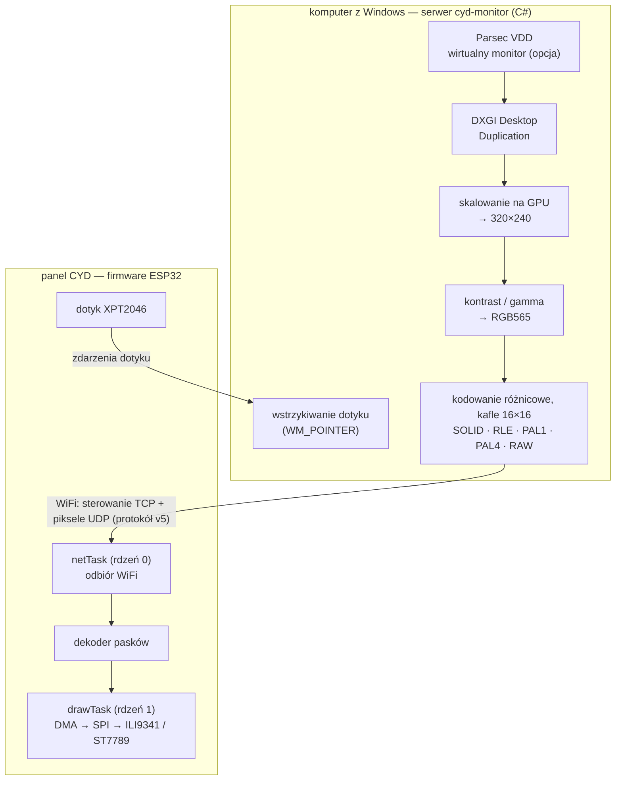

Panel działa jako **drugi monitor Windows** — widoczny w Ustawieniach ekranu, z obrazem przesyłanym po WiFi,
skalowanym z normalnej rozdzielczości na 320×240, z działającym dotykiem — albo pokazuje istniejący ekran.
Specyfikacja protokołu (po polsku): [docs/protocol-v5-udp.pl.md](docs/protocol-v5-udp.pl.md).

<p align="center">
  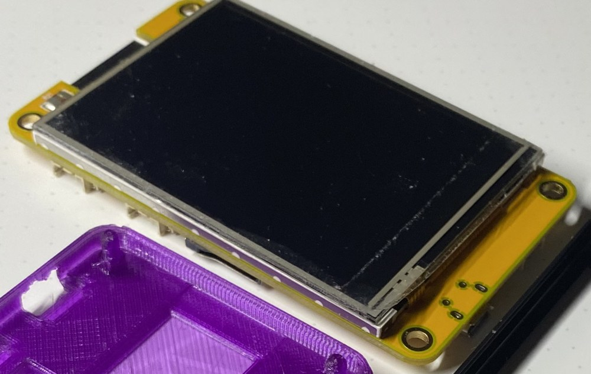
  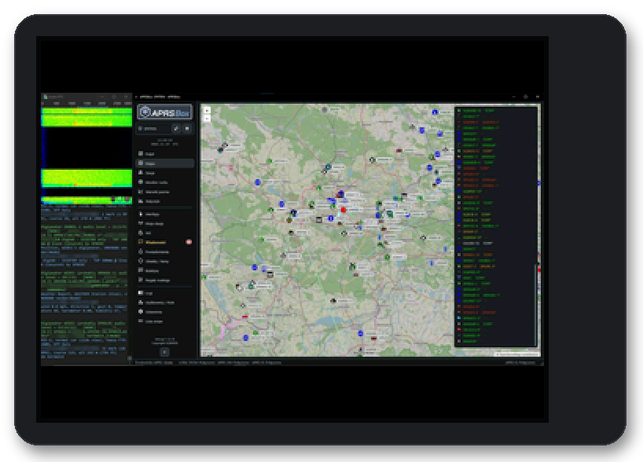
</p>
<p align="center"><sub>Z lewej: płytka ESP32-2432S028R (zdjęcie: projekt
<a href="https://github.com/witnessmenow/ESP32-Cheap-Yellow-Display">ESP32-Cheap-Yellow-Display</a>, licencja MIT).
Z prawej: symulacja lustra — pulpit 1920×1080 dopasowany do 320×240 i zredukowany do RGB565, tak jak robi to serwer.</sub></p>

## Dlaczego tak, a nie inaczej

Trzy decyzje wyszły z pomiarów, nie z założeń. Warto je znać, bo wyznaczają granice tego, co ten układ potrafi.

### Przechwytywanie: DXGI, nie GDI

Pierwsza wersja używała GDI (`StretchBlt` z DC ekranu). Pomiar (`--benchcapture`) pokazał, że **odczyt ekranu przez
GDI jest zsynchronizowany z odświeżaniem monitora**:

<picture>
  <source media="(prefers-color-scheme: dark)" srcset="docs/images/chart_capture_pl_dark.png">
  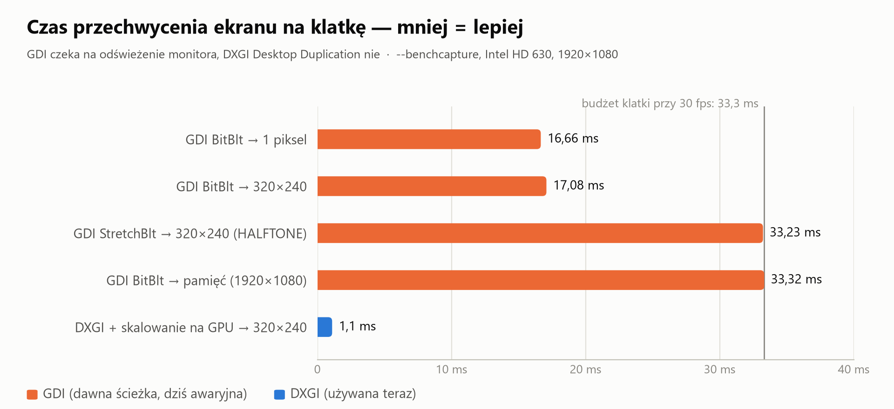
</picture>

```
BitBlt ekran -> 1 piksel                 16.66 ms   <- dokładnie jeden vblank przy 60 Hz
BitBlt ekran -> 320x240                  17.08 ms
StretchBlt ekran -> 320x240 (HALFTONE)   33.23 ms   <- dwa vblanki
BitBlt ekran -> pamięć (1920x1080)       33.32 ms
```

Koszt nie zależy od liczby pikseli — jednopikselowy odczyt kosztuje tyle samo co ćwierć ekranu. To jest *czekanie*,
nie praca, więc żaden tryb skalowania ani bufor pośredni tego nie skróci. 33,3 ms to cały budżet klatki przy 30 fps,
bez miejsca na konwersję, kodowanie i sieć.

DXGI Desktop Duplication nie ma tej blokady, oddaje gotową teksturę na GPU (więc skalowanie jest darmowe) i zwraca do
pamięci systemowej tylko wynik 320×240 zamiast pełnych 8 MB. Po zmianie:

```
przechwycenie + skalowanie   1.10 ms
kontrast/gamma/dithering     1.13 ms
kodowanie różnicowe          0.41 ms
najgorsza klatka            14.13 ms   (budżet: 33.3 ms)
```

Ścieżka GDI została jako awaryjna (`--gdi`), bo Duplication bywa odmawiane w niektórych sesjach. Daje wtedy ~25–30 fps
bez zapasu.

### Kodowanie: kafle i pięć trybów

Surowa klatka 320×240 RGB565 to 153,6 kB. Przy 30 fps to 37 Mbit/s — poza zasięgiem WiFi w ESP32. Dlatego wysyłane są
tylko zmienione kafle 16×16, sklejane w poziome paski, a każdy pasek koduje się tym z pięciu sposobów, który wychodzi
najkrócej: `SOLID`, `RLE`, `PAL1` (2 kolory, bitmapa), `PAL4` (≤16 kolorów, 4 bity/piksel) albo `RAW`.

Pulpit to głównie płaskie kolory, więc to działa dobrze — pełne odświeżenie schodzi ze 150 kB do ok. 36 kB. Zwykłe
zmiany na pulpicie to ~1 kB na klatkę.

### Dithering domyślnie wyłączony

Tu jest realny kompromis, zmierzony na prawdziwym pulpicie:

<picture>
  <source media="(prefers-color-scheme: dark)" srcset="docs/images/chart_dithering_pl_dark.png">
  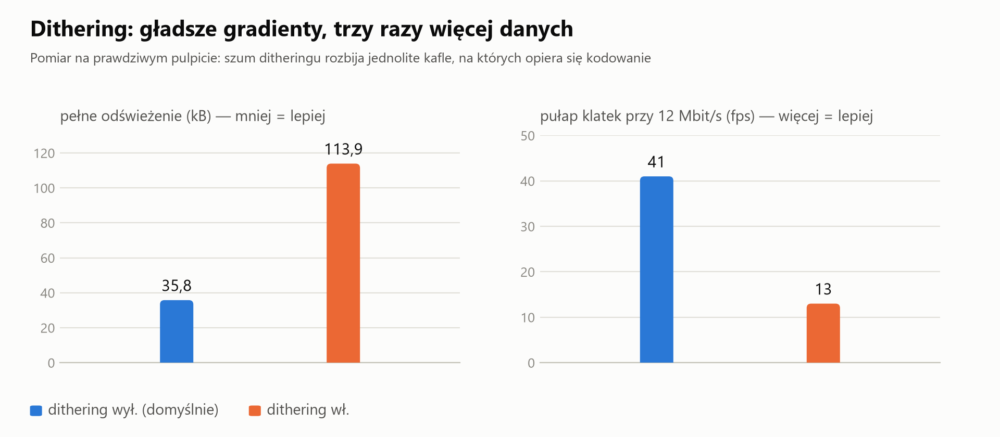
</picture>

| | pełne odświeżenie | pułap przy 12 Mbit/s |
|---|---|---|
| dithering **wył.** (domyślnie) | 35,8 kB | **41 fps** |
| dithering **wł.** | 113,9 kB | 13 fps |

Dithering ukrywa pasy na gradientach, ale szum, który dodaje, niszczy kompresję — kafel przestaje być jednolity. Pulpit
ma mało gradientów, więc domyślnie wygrywa płynność. Włącza się na stronie ustawień panelu albo flagą `--dither`.

## Uruchomienie ze źródeł

### 1. Firmware

```powershell
powershell -ExecutionPolicy Bypass -File scripts\build-firmware.ps1
```

Skrypt używa [arduino-cli](https://github.com/arduino/arduino-cli) z `tools\arduino-cli.exe` i konfiguracji
w `%LOCALAPPDATA%\cyd-arduino` (kompilatory i SDK to ok. 1,5 GB, wspólne dla wszystkich szkiców, więc nie w folderze
projektu). Port wykrywa sam; `-CompileOnly` tylko kompiluje. Dla późnych płytek „v3” z układem ST7789 zamiast ILI9341
(objaw: odwrócone kolory) dodaj `-St7789`. Jeśli panel iskrzy, zmniejsz zegar: `-SpiHz 65000000`.

Jednorazowa konfiguracja (wersje, na których zbudowano wydanie: rdzeń ESP32 3.3.11, LovyanGFX 1.2.29, JPEGDEC 1.8.4):

```powershell
$d = "$env:LOCALAPPDATA\cyd-arduino"; $a = "tools\arduino-cli.exe"
& $a config init --dest-dir $d
& $a --config-file $d\arduino-cli.yaml config set directories.data "$d\data"
& $a --config-file $d\arduino-cli.yaml config set directories.downloads "$d\downloads"
& $a --config-file $d\arduino-cli.yaml config set directories.user "$d\user"
& $a --config-file $d\arduino-cli.yaml config add board_manager.additional_urls https://espressif.github.io/arduino-esp32/package_esp32_index.json
& $a --config-file $d\arduino-cli.yaml core update-index
& $a --config-file $d\arduino-cli.yaml core install esp32:esp32@3.3.11
& $a --config-file $d\arduino-cli.yaml lib install LovyanGFX@1.2.29 JPEGDEC@1.8.4
```

### 2. WiFi na panelu

Po pierwszym starcie CYD wystawia sieć **`CYD-Monitor-Setup`**. Połącz się z nią i otwórz `http://192.168.4.1` —
formularz przyjmuje SSID, hasło i opcjonalnie IP serwera. Puste IP oznacza automatyczne wyszukanie (panel woła
rozgłoszeniowo po UDP, serwer odpowiada).

Dane zapisują się w NVS. Ponowna konfiguracja: przytrzymaj **BOOT** przez sekundę, gdy panel nie może połączyć się
z siecią (albo przycisk „Resetuj sieć” na stronie ustawień panelu).

### 3. Sterownik wirtualnego monitora (opcja, raz, jako administrator)

```powershell
powershell -ExecutionPolicy Bypass -File scripts\install-virtual-display.ps1
```

Instaluje [Parsec VDD](https://github.com/nomi-san/parsec-vdd) — podpisany sterownik na licencji MIT. Skrypt sprawdza
podpis Authenticode przed uruchomieniem czegokolwiek i przerywa, jeśli jest nieprawidłowy.

Aplikacja GUI, która instaluje się przy okazji, nie jest do niczego potrzebna: serwer rozmawia ze sterownikiem
bezpośrednio przez IOCTL. **Wirtualny monitor istnieje tylko wtedy, gdy serwer działa** — sterownik odłącza ekran mniej
więcej sekundę po ostatnim sygnale podtrzymania, więc awaria serwera nie zostawia po sobie pulpitu rozciągniętego na
nieistniejący ekran.

### 4. Serwer

Wymaga [.NET 10 SDK](https://dotnet.microsoft.com/download) (gotowy `cyd-monitor.exe` z Releases ma .NET w środku).

```powershell
dotnet run --project server\cyd-monitor -- --virtual
```

Bez sterownika można od razu pokazać istniejący ekran:

```powershell
dotnet run --project server\cyd-monitor -- --monitor 1
```

### 5. Serwer w tle i autostart

Serwer nie musi być oknem, którego ktoś pilnuje. Najprościej: **`scripts\enable-service.cmd`** — uruchamia serwer
teraz i rejestruje autostart (cofa to `disable-service.cmd`). Pojedyncze kroki (każdy z `.cmd` do kliknięcia):

| Plik | Co robi |
|---|---|
| `start-cyd` / `stop-cyd` | uruchamia / zatrzymuje sam serwer (ukryty, niezależny od okna) |
| `start-cyd-watchdog` / `stop-cyd-watchdog` | włącza / wyłącza zadanie „CYD-Watchdog”: po zalogowaniu i potem co 30 s sprawdza, czy serwer działa, i uruchamia go, gdy nie |

Watchdog włącza się raz (`start-cyd-watchdog`), potem serwer wstaje sam po każdym restarcie komputera. Przy włączonym
watchdogu `stop-cyd` jest cofane w ciągu ok. 30 s — żeby zatrzymać na stałe, najpierw `stop-cyd-watchdog`. Przed
przebudową serwera (`dotnet build`) zatrzymaj go przez `stop-cyd`: Windows nie nadpisze działającego pliku exe.

Serwer startuje przez WMI, a nie jako potomek okna czy zadania, więc nie ginie razem z nimi. Log watchdoga:
`%LOCALAPPDATA%\cyd-monitor\cyd-watchdog.log`.

## Ustawienia panelu (strona www panelu)

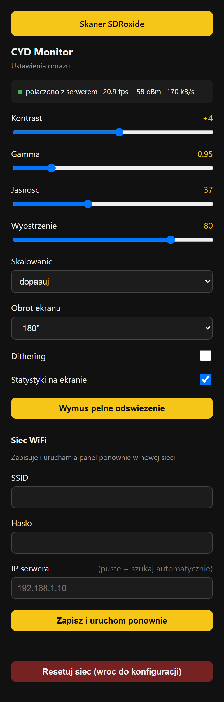

Wszystkie ustawienia obrazu są na stronie **`http://<IP panelu>`** (IP panel pokazuje po starcie i w statystykach).
Dawniejsze menu na samym panelu zostało usunięte: dotyk na panelu ma trafiać do Windows, a strona w telefonie jest
wygodniejsza.

| Pozycja | Gdzie działa | Uwagi |
|---|---|---|
| Kontrast | serwer (LUT) | ILI9341 nie ma rejestru kontrastu |
| Gamma | serwer (LUT) | 1,00 = bez zmian |
| Jasność | panel (PWM podświetlenia) | sprzętowa, bez straty kolorów |
| Wyostrzenie | serwer | maska wyostrzająca po skalowaniu |
| Skalowanie | serwer | dopasuj / rozciągnij / 1:1 (podąża za kursorem) |
| Obrót ekranu | panel | ±180° |
| Dithering | serwer | patrz wykres wyżej |
| Statystyki na ekranie | panel | fps, kB/s, RSSI, IP |
| Odwróć dotyk skanera | panel | gdy przyciski na dole reagują na dotyk u góry |
| Sieć WiFi | panel | zapis i restart w nowej sieci, reset do konfiguracji |

Ustawienia po stronie serwera pokazują się dopiero po jego potwierdzeniu (`MSG_OPTACK`), więc strona nigdy nie wyświetla
wartości, która nie weszła w życie. Na samej górze jest przycisk **Skaner SDRoxide** — otwiera stronę www skanera.

<br clear="right"/>

## Gesty na panelu

| Gest | Co robi |
|---|---|
| przeciągnięcie | przesuwa widok (lustro) |
| przytrzymanie 0,7 s bez ruchu | zoom 1× → 2× → 4× (lustro) |
| dwuklik | przełącza między lustrem a skanerem; na skanerze poza paskiem przycisków |
| stuknięcie w blok radia | włącza lub wyłącza dźwięk tego radia, po ok. 0,4 s (skaner) |

## Skaner SDR Oxide

<p align="center">
  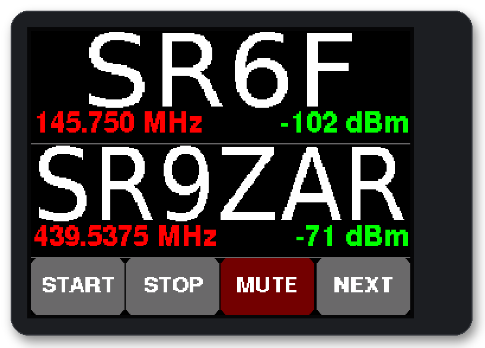
  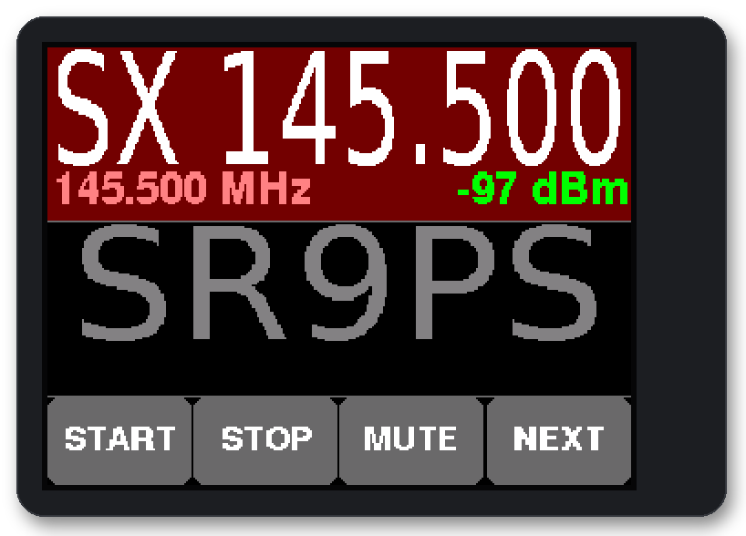
  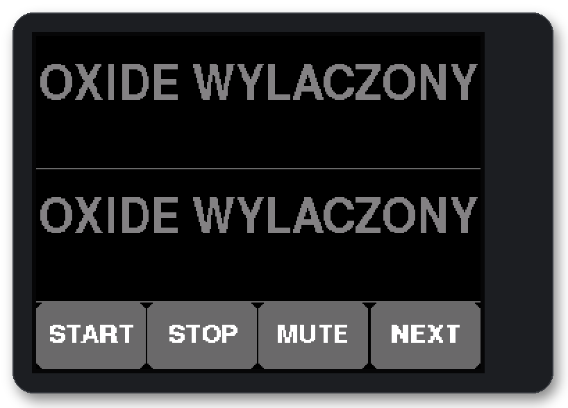
</p>
<p align="center"><sub>Symulacje z kodu firmware: dwie transmisje naraz przy wyciszonej karcie (MUTE) · radio 2 m z wyłączonym
dźwiękiem (ciemnoczerwony blok), 70 cm zatrzymane na kanale · SDR Oxide zamknięty.</sub></p>

Strona skanera zastępuje lustro na całym ekranie: dwa bloki, po jednym na radio (nazwa kanału, częstotliwość, poziom),
a pod nimi wspólny pasek START, STOP, MUTE, NEXT. Radio bez transmisji pokazuje `SKANUJE` z ruchomym paskiem, a skaner
wyłączony: bieżący kanał pamięci, a poza pamięcią samą częstotliwość zamiast nazwy, na szaro. Otwiera ją dwuklik albo
sama transmisja: panel wyskakuje z lustra i wraca do niego sekundę po jej końcu. Dwuklik na oknie, które wyskoczyło
samo, zamyka je do końca tej transmisji. Strona otwarta dwuklikiem zostaje, dopóki jej nie zamkniesz. Na czas skanera
serwer wstrzymuje przechwytywanie obrazu.

Dane idą przez wbudowane serwery Hamlib rigctld w Oxide: **4532** dla SDR 2M i **4533** dla SDR 70CM, oba na 127.0.0.1,
z wyłączonym nadawaniem (Ustawienia → Servers, osobno dla każdego radia). Bez nich strona pokazuje `OXIDE WYLACZONY`,
a radio wyłączone na liście radiów Oxide (`radios.json`, `enabled: false`; tak wygląda wariant z jednym odbiornikiem
skanującym oba pasma) pokazuje `RADIO WYLACZONE`, a na stronie www nie ma swojej karty. Serwer łączy się na czas
pytania i od razu się rozłącza: Oxide obsługuje każde otwarte połączenie wątkiem kręcącym się na gnieździe, czyli
jeden cały rdzeń na połączenie.

Część poleceń wymaga łatek z [wersji SP9TKN SDR Oxide](https://github.com/SP9TKN/sdroxide-brown) (`latka_skan.py`,
`latka_pamiec.py`, `latka_pomin.py`, `latka_sluch.py`, `latka_www.py`); bez nich serwer cofa się do naciskania
przycisków Oxide przez Windows UI Automation albo ukrywa daną funkcję.

- **Zatrzymanie:** częstotliwość stoi co najmniej 0,4 s, bo skan przeskakuje co ok. 150 ms.
- **Transmisja:** zatrzymanie plus poziom ponad blokadą szumów z `modeprofiles.json` danego radia, przeliczoną przez
  `cal_offset_db` z `config.toml`. Sam postój nie wystarcza, bo skaner wyłączony też stoi.
- **Nazwa:** z `memories.json`, najpierw z folderów skanowanych przez to radio (`scanner.json`). Polskie znaki tracą
  ogonki, bo czcionki panelu są ASCII.
- **Uruchamianie i zamykanie Oxide:** START przy wyłączonym programie uruchamia go (bez okna konsoli, wyjście trafia do
  `oxide.log` w folderze danych serwera; program to `D:\oxide-build\bin\sdroxide.exe` (kompilacja autora), gdy jest,
  inaczej `..\oxide\sdroxide.exe` obok folderu serwera, jak w paczce przenośnej, a na końcu instalacja w Program
  Files), a kolejny START włącza skanowanie. STOP zatrzymuje skanowanie, a kolejny STOP, przy obu skanerach już
  wyłączonych, zamyka program zwykłym zamknięciem okna. Drugi STOP liczy się dopiero po sekundzie, żeby drgnięcie
  dotyku nie zamknęło programu.
- **Zamykanie zminimalizowanego Oxide:** program zapisuje wtedy okno z pozycją -32000 i rozmiarem 0, a potem pada przy
  każdym starcie (`min > max` w `oxide.log`). Serwer przywraca okno przed zamknięciem, a gdy Oxide nie działa, sam
  poprawia wpis `window` w `%APPDATA%\sdroxide\data\app.ron` (kopia: `app.ron.bak-okno`).
- **START, STOP, NEXT:** działają na oba radia, NEXT tylko na to, które stoi. NEXT przy zatrzymanym skanerze (kliknięty
  kanał, wpisana częstotliwość) uruchamia go i od razu idzie dalej, żeby nie trzeba było najpierw START. Oxide z
  `latka_skan.py` dostaje je przez rigctld: `g MEM 0` (start), `g STOP 0`, `g NEXT 0`, a stan czyta `u SCAN`; SKIP-a
  tam celowo nie ma. Oxide Brown przebudowuje okno skanera przy każdym przeskoku, więc NEXT klikany przez UIA znikał,
  zanim dało się go nacisnąć. Bez łatki serwer naciska przyciski przez Windows UI Automation (`OxideUi.cs`). Okno
  `Scanner` nie musi być otwarte: serwer rozwija je albo otwiera na ułamek sekundy i przywraca poprzedni stan, a
  zminimalizowany Oxide wraca na ten czas bez przejmowania fokusu.
- **RAM przy zminimalizowanym Oxide:** okno trzyma w pamięci cały obraz (około 400 MB grafiki). Po każdej minimalizacji
  serwer raz opróżnia zestaw roboczy Oxide (`EmptyWorkingSet`): to, czego używa odbiór, wraca od razu, a grafika okna
  dopiero po jego otwarciu. Pamięć zarezerwowana przez program się nie zmienia, zwalnia się RAM dla innych programów
  (pomiar: 658 → 76 MB w Menedżerze zadań, bez zgubionych próbek).
- **Widok dzielony ⊞:** radio bez panelu nie ma przycisków, a Oxide nie pamięta tego widoku po restarcie. Serwer
  sprawdza to co 5 s i raz na uruchomienie Oxide, po ok. 8 s od startu, naciska ⊞ na ukrytym radiu, a potem minimalizuje
  Oxide bez przejmowania fokusu, żeby na pulpicie został APRS. Minimalizuje tylko po włączeniu panelu, więc restart
  serwera nie chowa okna. Panel zamknięty ręcznie zostaje zamknięty, dopóki nie będzie potrzebny dla przycisku z CYD.
- **MUTE:** wyciszenie karty, na której gra Oxide (`audio_output` w `config.toml`), tak samo jak ikona głośnika
  w Windows. Ciemnoczerwony przycisk oznacza wyciszenie. Pusta albo nieznana nazwa karty oznacza domyślną kartę Windows,
  tak jak w samym Oxide.
- **Dotyk na stronie skanera:** pierwszy panel podaje współrzędną Y odwróconą, więc strona skanera ją odwraca. Nie
  każdy egzemplarz tak ma, dlatego to ustawienie panelu: „Odwróć dotyk skanera” na jego stronie www
  (`/api/set key=scanflip`, w NVS jako `sfy`, domyślnie włączone). Lustro korzysta tylko z ruchu palca, więc go to nie
  dotyczy.
- **Dźwięk jednego radia:** stuknięcie w jego blok przełącza MUTE tego radia w Oxide (`U MUTE` przez Hamlib),
  a ciemnoczerwone tło bloku oznacza wyłączony dźwięk. Wyciszone radio nadal otwiera okno przy transmisji.

Testy bez panelu, z folderu serwera:

```
cyd-monitor --skaner-test 30          # co dostałby panel przy otwartej stronie
cyd-monitor --skaner-okno 60          # kiedy okno by wyskoczyło
cyd-monitor --skaner-klik 1 stop      # naciska przycisk: radio 0|1, start|stop|next [Hz]
cyd-monitor --skaner-minimalizuj      # minimalizuje Oxide
cyd-monitor --skaner-napraw app.ron   # naprawia wpis okna w podanym pliku stanu
```

Na panelu `POST /api/set` z `key=scan&value=1` (lub `0`) otwiera i zamyka stronę, a `/api/state` podaje `scan` oraz
ostatni dotyk w `touchX`, `touchY`.

## Pokrętło Ulanzi D100H

<p align="center">
  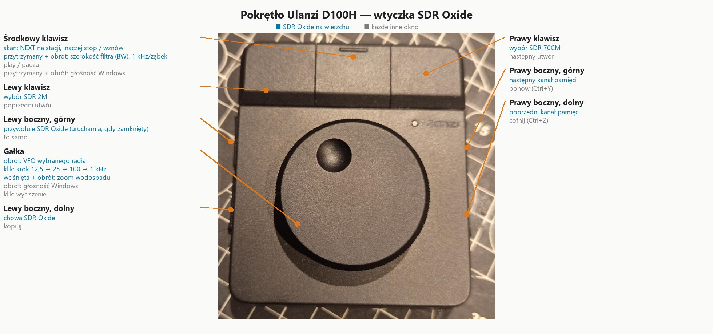
</p>

Pokrętło steruje SDR Oxide przez wtyczkę w Ulanzi Studio ([`ulanzi-plugin/`](ulanzi-plugin/README.pl.md)) i moduł
`DialBridge.cs` tego serwera. Wtyczka nie ma własnej logiki: każde zdarzenie wysyła jako `GET` na `127.0.0.1:7792`.
To serwer przy każdym zdarzeniu sprawdza, czy Oxide jest na wierzchu.

| Element | Oxide na wierzchu | Każde inne okno |
|---|---|---|
| Lewy nad pokrętłem | wybiera SDR 2M | poprzedni utwór |
| Środkowy nad pokrętłem, krótko | skan stoi na stacji: NEXT; inaczej zatrzymuje/wznawia skan wybranego radia | play/pauza |
| Środkowy przytrzymany i kręcenie | szerokość filtra (BW) wybranego radia, 1 kHz na ząbek | głośność Windows |
| Prawy nad pokrętłem | wybiera SDR 70CM | następny utwór |
| Pokrętło | VFO wybranego radia | głośność Windows |
| Pojedynczy klik pokrętła | zmienia krok: 12,5 → 25 → 100 → 1 kHz | wyciszenie Windows |
| Wciśnięte i kręcone | zoom wodospadu wybranego radia | głośność Windows |
| Lewy górny boczny | przywołuje Oxide (uruchamia, gdy nie działa) | to samo |
| Lewy dolny boczny | chowa Oxide, wraca okno spod spodu | Kopiuj |
| Prawy górny boczny | następny kanał pamięci (w górę listy) wybranego radia | Redo (Ctrl+Y) |
| Prawy dolny boczny | poprzedni kanał pamięci (w dół listy) wybranego radia | Undo (Ctrl+Z) |

- **Wybór radia** to też akcentowa ramka zakładki w Oxide. Tekst zakładki nie ma w UIA akcji, więc to kliknięcie
  wysłane do okna (`PostMessage`): nie rusza kursora ani fokusu. Serwer pamięta wybór do restartu, potem wraca na 2 m.
- **Kanały pamięci:** lista to foldery zaznaczone w skanerze tego radia (bez zaznaczenia: wszystkie kanały),
  w zapisanej kolejności, razem z kanałami na SKIP, a po końcu wraca na początek. Przywołanie idzie przez `E <numer>`
  w rigctld, którego zwykły Oxide nie ma (łatka `latka_pamiec.py` w
  [wersji SP9TKN](https://github.com/SP9TKN/sdroxide-brown)), a nie przez `F`, bo kanał niesie też filtr, przesunięcie
  i ton. Przywołanie kończy skan na tym radiu, a środkowy przycisk go wznawia.
- **Pokrętło idzie przez rigctld** (`F`). `F` kończy skan tylko na tym radiu, więc pokręcenie zatrzymuje skan,
  a środkowy przycisk go wznawia. Strojenie ląduje na wielokrotności kroku, tak jak strojenie w samym Oxide. Krok jest
  wspólny dla obu radiów i nie jest nigdzie wyświetlany: widać go na cyfrach przy następnym obrocie. Po restarcie
  serwera wraca 12,5 kHz.
- **Zoom** to kółko myszy wysłane do okna (`PostMessage`) nad środkiem wodospadu panelu, jeden ząbek kółka na każdy
  ząbek pokrętła. Działa,
  gdy prawdziwy kursor jest nad oknem Oxide, a tak jest przy zmaksymalizowanym oknie na wierzchu. Inaczej Windows
  zgłasza kursor poza oknem i kółko przepada.
- **Szerokość filtra:** rigctld przyjmuje pasmo w `M`, odpowiada `RPRT 0` i nic nie zmienia, a TCI nie ma filtra.
  Dlatego `ulanzi-plugin\set-oxide-filter-keys.py` wiąże F13/F14 z akcją `FilterWidth` w `input.json` Oxide, a serwer
  naciska te klawisze. Skrót trafia do panelu z akcentową ramką, więc serwer najpierw ją ustawia. Środkowy guzik działa
  przy puszczeniu: to, czy był kręcony, ustala wtyczka, bo tylko tam zdarzenia idą jeszcze po kolei. Skaner po
  zatrzymaniu na kanale nakłada filtr zapisany w pamięci, więc taka zmiana trwa do następnego kanału.
- **Dlaczego nie osobny preset dla sdroxide.exe:** Studio 3.4.8 zawiesza się na stałe przy przełączaniu na taki preset,
  a po wyłączeniu „Preset Switch Reminder” nie przełącza się na niego wcale. Sprawdzone 2026-10-31.
- **Pierwszy plan:** Windows oddaje go tylko procesowi, który widział ostatnie wejście, więc serwer wysyła najpierw
  puste zdarzenie myszy (`SendInput`), a potem `SetForegroundWindow`.
- **Wymaga:** działającego Ulanzi Studio (autostart) i tego serwera. Bez serwera przyciski i pokrętło na tym presecie
  nic nie robią, także głośność Windows.
- **Po uśpieniu:** pokrętło wybudzone po długiej przerwie potrafi nie przejść uwierzytelnienia (`HidDeviceAuth failed`
  w logu Studia), a Studio czeka wtedy do kolejnego wybudzenia i żaden przycisk nie działa. `cyd-watchdog.ps1` co 5 s
  czyta koniec logu Studia i w takim stanie restartuje Studio; uruchamia je też, gdy nie działa. Ślad
  w `cyd-watchdog.log`.

Instalacja: [ulanzi-plugin/README.pl.md](ulanzi-plugin/README.pl.md). Test bez pokrętła:
`curl http://127.0.0.1:7792/vol/1`, a także `/tune/1`, `/hold/1`, `/filter/1`, `/radio/1`, `/scan`, `/show`, `/hide`,
`/press`.

## Strona www skanera

<p align="center">
  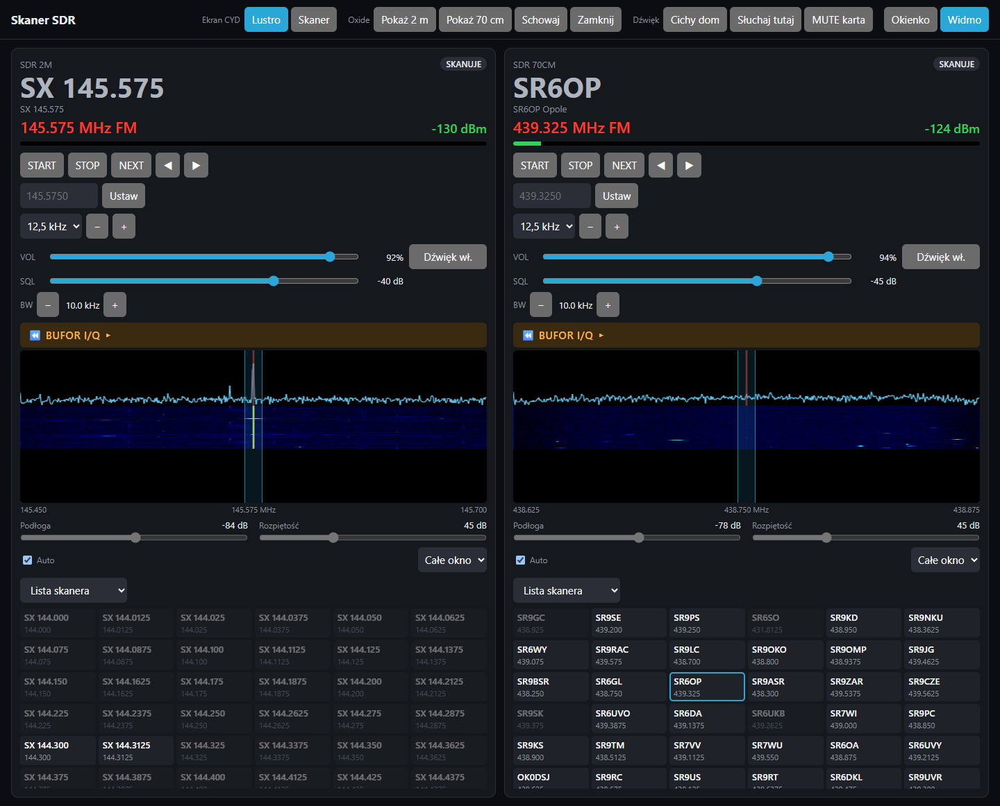
  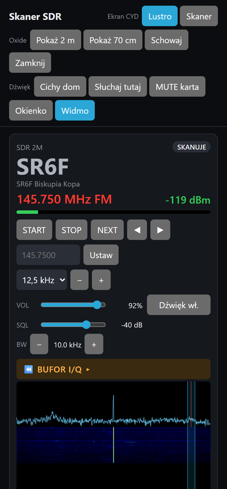
</p>
<p align="center"><sub>Strona www skanera na komputerze i na telefonie (prawdziwe zrzuty, kanały to publiczne przemienniki
i kanały simplex).</sub></p>

Serwer na PC wystawia stronę `http://<IP komputera>:7793/`; strona panelu ma do niej na samej górze przycisk
`Skaner SDRoxide`. Pokazuje oba radia: stan, kanał, częstotliwość, poziom, widmo z wodospadem i listę kanałów
z zaznaczonym bieżącym. Steruje skanerem (START, STOP, NEXT dla każdego radia osobno), kanałami, częstotliwością
(wpisaną albo przesuwaną krokiem), głośnością i dźwiękiem radia, blokadą szumów, szerokością BW, wyciszeniem karty,
ekranem CYD (lustro lub skaner) oraz oknem Oxide. Podłoga, rozpiętość i szerokość obrazu widma są zapamiętywane
w przeglądarce i nie zmieniają niczego w Oxide. Nadawania tam nie ma.

Kliknięcie kanału na liście dołącza go do skanowania pamięci albo go z niego wyłącza (wyszarzony = pomijany) i ustawia
na nim radio, co kończy skanowanie na tym radiu. Zmianę robi sam Oxide (`g EXCL <id>` / `g INCL <id>` w rigctld,
`latka_pomin.py`), więc trafia do `scanner.json` i do jego okna skanera. Na widmie półprzezroczysty pas pokazuje
szerokość filtra (BW), a czerwona linia częstotliwość radia.

**Dźwięk na stronie:** trzy niezależne przełączniki, każdy robi tylko swoje. `Słuchaj tutaj` gra w przeglądarce oba
radia zmiksowane, więc telefon gra dalej w tle i przy zgaszonym ekranie, z kafelkiem na ekranie blokady (Media
Session). `Cichy dom` wycisza tylko Oxide w mikserze głośności Windows (jego sesje na karcie z `audio_output`), więc
skanera nie słychać w domu, a inne dźwięki komputera grają. `MUTE karta` wycisza całą kartę. Przycisk `Okienko`
włącza pływające okienko z obu radiami (nazwa, częstotliwość, poziom; wideo z kanwy z dźwiękiem skanera), które
pojawia się dopiero po zminimalizowaniu przeglądarki i chowa po powrocie. Telefon (Chrome na Androidzie) robi okienko
tylko z wideo, które jest na pełnym ekranie w chwili wyjścia, a strona nie może wejść na pełny ekran w drodze do tła.
Dlatego przycisk przełącza na pełny ekran całą stronę (z `navigationUI: 'show'`, więc pasek nawigacji Androida
zostaje, znikają pasek stanu i pasek adresu), wyglądającą jak zwykle, a wideo leży pod nią, niewidoczne, na cały ekran
(klasa `czeka`): przeglądarka uznaje je za wideo na pełnym ekranie. Home zmniejsza stronę do okienka, a styl
`@media (max-height:320px)` pokazuje wtedy wideo zamiast strony. Wyjście z pełnego ekranu (gest wstecz) albo drugie
dotknięcie przycisku wyłącza tryb. Komputer otwiera okienko przez API Picture-in-Picture od razu; powrót na kartę
zamyka je i wyłącza tryb. Dźwięk płynie z kolejki Web Audio (około 0,3 s opóźnienia) przez odtwarzacz multimediów,
więc gra też w tle. Dźwięk idzie z TCI (`/api/dzwiek`, 16 kHz, mono, 16 bitów, około 32 kB/s) i omija kartę. Zwykłe
TCI daje dźwięk sprzed blokady szumów, dla dekoderów, więc serwer prosi Oxide z `latka_sluch.py`
o `audio_heard:true;`: to, co przepuściła blokada, razem z głosem cyfrowym. Echo tej komendy mówi serwerowi, że
prośba zadziałała. Bez echa, czyli na Oxide bez łatki, otwiera poziom sygnału, spóźniony o jeden odczyt. W obu razach
dźwięk jest sprzed głośności i wyciszenia radia, więc te dwa stosuje serwer. Zamknięcie strony niczego nie włącza
z powrotem: `Cichy dom` i `MUTE karta` zostają, jak je zostawiono.

SQL i BW wymagają Oxide z `latka_www.py` (`l SQL`, `L SQL`, `M <tryb> <szerokość>` w rigctld); bez niej te dwa wiersze
są ukryte. Blokada działa jak suwak w Oxide, czyli osobno dla trybu, w którym radio teraz jest. BW idzie po kolei: 1,
5, 7, 10, 12,5, 15, 25, 100 kHz. Oxide z `latka_bw25.py` daje w FM do 48 kHz (krawędź do 24 kHz od nośnej), bez niej
ucina na 24 kHz; 100 kHz w pełni działa w WFM. BW trwa do następnego zatrzymania skanera, bo kanał przywraca swój filtr.

- **Dane:** stan przez rigctld (`ScannerWeb.cs`), widmo przez IQ z serwerów TCI Oxide: **50001** SDR 2M i **50002**
  SDR 70CM, oba na 127.0.0.1. Dla drugiego radia trzeba włączyć TCI w `radio-1\tciserver.json` (lub Ustawienia →
  Servers tego radia).
- **Koszt:** rigctld i IQ są czytane tylko przy otwartej, widocznej stronie. Przycisk `Widmo` wyłącza IQ, jeśli
  strona jest używana przez słabe łącze. Oxide musi mieć poprawkę TCI (`set_nonblocking(false)` w
  `server/client.rs`); bez niej każde połączenie TCI zajmuje rdzeń.
- **Dostęp:** bez hasła, jak strona panelu, więc tylko dla sieci lokalnej i Tailscale. Polecenia z innej witryny są
  odrzucane (nagłówek `Origin`). **Nie przekierowuj portu na routerze.**
- **Podczas skanowania** widmo przeskakuje razem z radiem, bo przy małej szybkości próbkowania prawie każdy kanał to
  inne okno; stabilny obraz jest przy zatrzymaniu.

Test obok działającego serwera: `cyd-monitor --skaner-www 60`.

## Ile klatek naprawdę

Zmierzone na komputerze z Intel HD 630, 1920×1080:

* **serwer**: 3,5 ms na klatkę średnio, 14 ms w najgorszym przypadku — mieści się w 33,3 ms z dużym zapasem;
* **łącze**: typowe zmiany na pulpicie to ~1 kB/klatkę, czyli 0,3 Mbit/s przy 30 fps — łącze nie jest tu
  ograniczeniem;
* **pełne odświeżenie** (przełączenie okna na cały ekran) to 35,8 kB, czyli 20 fps przy 6 Mbit/s, 41 fps przy
  12 Mbit/s;
* **panel**: pełna klatka po SPI przy 80 MHz to 15,4 ms. Dlatego firmware ma dwa taski na dwóch rdzeniach — sieć i SPI
  nakładają się na siebie zamiast sumować.

**Czego to nie zrobi:** treść fotograficzna na pełnym ekranie (film, pokaz zdjęć) nie ma płaskich obszarów, więc spada
do trybu `RAW` i tam o liczbie klatek decyduje wyłącznie WiFi. Kodowanie stratne by to naprawiło, ale kosztem dekodera
JPEG na ESP32, który zjada więcej milisekund, niż oszczędza.

## Kabel nie wystarczy

CYD ma klasyczny ESP32-WROOM bez natywnego USB — port to mostek CH340, czyli UART. Przy 2 Mbaud daje ok. 200 kB/s,
a jedna klatka RGB565 to 153 kB. Dlatego obraz idzie po WiFi, a kabel służy wyłącznie do wgrywania firmware i do
diagnostyki na konsoli szeregowej.

## Diagnostyka

```powershell
dotnet run --project server\cyd-monitor -- --list          # monitory i tryby 4:3
dotnet run --project server\cyd-monitor -- --selftest 60   # sprawdź kodek, zmierz ruch
dotnet run --project server\cyd-monitor -- --benchcapture  # porównaj ścieżki przechwytywania
```

`--selftest` koduje prawdziwe klatki z pulpitu i odtwarza je **niezależną implementacją dekodera**
(`SelfTest.Decode`), która jest celowo osobnym kodem od firmware'owego `decodeStrip()` — sens polega na wyłapaniu
rozjazdu między dwiema implementacjami tej samej specyfikacji. To właśnie ten test wykrył błędnie policzony rozmiar
nagłówka paska (11 zamiast 13 bajtów), zanim cokolwiek trafiło na sprzęt.

### Typowe problemy

**Panel nie znajduje serwera.** Wykrywanie działa przez rozgłoszenie UDP na porcie 7787 — zapora Windows musi
przepuścić `cyd-monitor`. Obejście: wpisz IP serwera w portalu konfiguracyjnym. Sieć „dla gości” w routerze często
blokuje urządzenia między sobą.

**Nieznane urządzenie USB / kod 43 przy wgrywaniu.** To nie jest brak sterownika — Windows nie zdołał odczytać
deskryptorów, więc żaden sterownik nie ma się do czego podpiąć. Sterowniki `ch341ser.inf`, `ch343ser.inf`
i `silabser.inf` są w magazynie Windows i podepną się same. Przyczyna jest fizyczna: kabel bez linii danych, luźne
gniazdo micro-USB albo hub.

**Panel iskrzy albo ma przekłamane piksele.** Zegar SPI za wysoki dla egzemplarza — przebuduj z `-SpiHz 65000000`.

## Skąd co pochodzi

* [nomi-san/parsec-vdd](https://github.com/nomi-san/parsec-vdd) — sterownik wirtualnego monitora (MIT) i jego
  interfejs IOCTL, na którym oparty jest `VirtualDisplay.cs`.
* [witnessmenow/ESP32-Cheap-Yellow-Display](https://github.com/witnessmenow/ESP32-Cheap-Yellow-Display) — rozpiska
  wyprowadzeń płytki; potwierdziła konfigurację w `lgfx_cyd.h`. Z tego repozytorium (MIT) pochodzi też zdjęcie płytki.
* [LovyanGFX](https://github.com/lovyan03/LovyanGFX) — sterownik panelu. Wybrany zamiast TFT_eSPI, bo na tej płytce
  panel i dotyk siedzą na **dwóch różnych szynach SPI** (panel 14/13/12, XPT2046 25/32/39/33). TFT_eSPI zakłada wspólną
  szynę, więc wymagałby drugiej biblioteki i ręcznego zarządzania dostępem; LovyanGFX przyjmuje osobny `spi_host` per
  urządzenie i ma DMA (`pushImageDMA`), bez którego 30 fps nie byłoby osiągalne.
* [Vortice.Windows](https://github.com/amerkoleci/Vortice.Windows) (MIT) — Direct3D 11 / DXGI w C#.
* Podobne projekty, na których widać alternatywne podejścia: [S3-tinyTV](https://github.com/RYUKIUN/S3-tinyTV)
  (kafle JPEG po UDP na ESP32-S3) i [ESP32-Screen-Mirroring](https://github.com/aayushchouhan24/ESP32-Screen-Mirroring).
* Obrazy ekranów panelu w tym README to symulacje wygenerowane z kodu rysującego firmware (`scanDrawRadio`,
  `scanDrawButton`) na tych samych czcionkach LovyanGFX; zdjęcia panelu i pokrętła — autora.

<!-- ecosystem:aprs:start -->

## Część stacji APRS SP9TKN

Pięć projektów działa razem jako jedna stacja APRS na komputerze z Windows i radiu Yaesu FT-290R II (2 m). Każda część robi jedną rzecz i działa też osobno.

| Projekt | Rola |
|---|---|
| [Wyzwalacz PTT ESP32](https://github.com/SP9TKN/esp32-ptt-pc818) | kluczuje PTT radia przez transoptor PC818 (separacja galwaniczna), diody TX/RX |
| [Audio PTT](https://github.com/SP9TKN/audio-ptt) | dźwięk z radia jako wodospad jak w UZ7HO + lampki PTT, tylko odczyt |
| [APRSBox dla Windows](https://github.com/SP9TKN/APRSBox) | program APRS: iGate, digipeater, beacony, wiadomości, mapa (port APRSBox SQ9MDD na Windows) |
| [CYD-Monitor](https://github.com/SP9TKN/cyd-monitor) **← tu jesteś** | wyświetlacz ESP32 2,8" jako monitor bezprzewodowy: ekran stacji przez WiFi, z dotykiem |
| [Direwolf — paczka SP9TKN](https://github.com/SP9TKN/direwolf) | modem / TNC na karcie dźwiękowej (AFSK 1200): Direwolf 1.8.1 WB2OSZ z ciemnym oknem konsoli i konfiguracją stacji (PTT na DTR, KISS TCP dla APRSBox) |

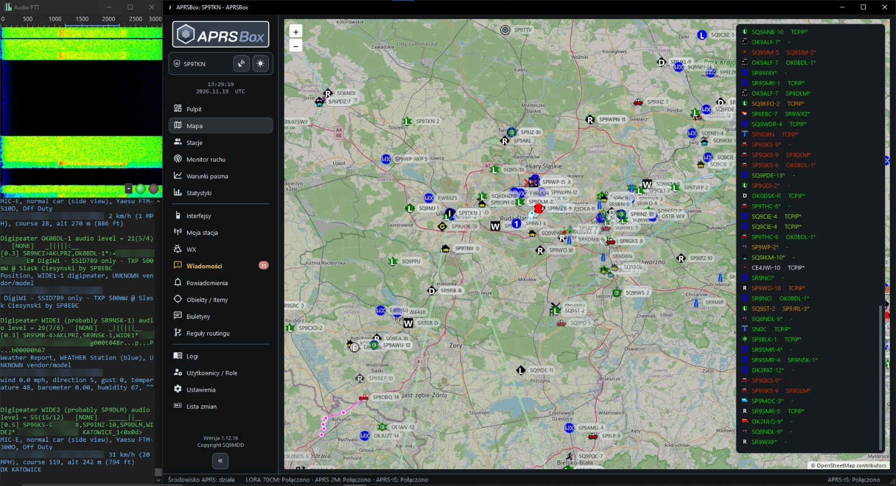
*Stacja w pracy: Audio PTT (u góry po lewej), Direwolf (na dole po lewej) i APRSBox z mapą. Współrzędne innych stacji w oknie Direwolfa są zamazane.*

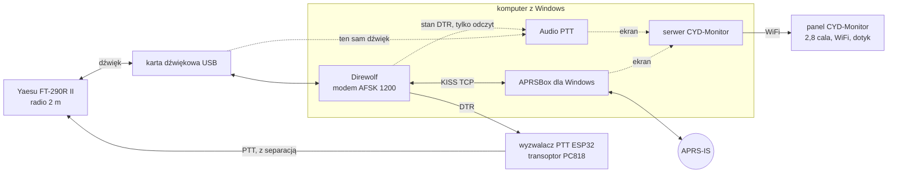

**Jak to działa**

1. **Odbiór.** Dźwięk z FT-290R II idzie przez kartę dźwiękową USB do **Direwolfa**, który dekoduje pakiety AFSK 1200
   i przekazuje je do **APRSBox** przez KISS TCP. APRSBox zapisuje je, rysuje na mapie, wysyła do APRS-IS (iGate)
   i powtarza według reguł digipeatera.
2. **Nadawanie.** APRSBox kolejkuje beacon, wiadomość albo ramkę do powtórzenia i przekazuje ją Direwolfowi przez KISS.
   Direwolf podnosi linię **DTR** na porcie szeregowym USB **wyzwalacza PTT ESP32** (`PTT COMx DTR`); płytka zwiera
   PTT radia przez transoptor PC818 i zapala czerwoną diodę, a Direwolf odtwarza dźwięk pakietu.
3. **Podgląd.** **Audio PTT** pokazuje ten sam dźwięk z radia jako wodospad, z dwiema lampkami, które idą za linią PTT.
   Stan DTR czyta z portu trzymanego przez Direwolfa, bez otwierania portu, więc nigdy nie przeszkadza w nadawaniu.
4. **Z każdego pokoju.** **CYD-Monitor** pokazuje pulpit stacji (mapę APRSBox, Audio PTT, okno Direwolfa)
   na wyświetlaczu ESP32 „Cheap Yellow Display” 2,8" przez WiFi. Ten sam panel jest też wyświetlaczem
   [skanera SDR SP9TKN](https://github.com/SP9TKN/cyd-monitor/blob/main/README.pl.md#część-skanera-sdr-sp9tkn): przeskakuje na stronę skanera, gdy SDR Oxide coś usłyszy.
5. **Bez nadzoru.** Skrypty watchdoga (w repozytorium APRSBox) uruchamiają ponownie program, który się zatrzymał,
   i odstawiają okna na miejsce po uśpieniu monitora; wirtualny ekran trzyma pulpit w 1920×1080, gdy fizyczny
   monitor jest wyłączony.

<!-- ecosystem:aprs:end -->

<!-- ecosystem:sdr:start -->

## Część skanera SDR SP9TKN

SDR Oxide, CYD-Monitor i pokrętło Ulanzi działają razem jako jeden skaner na dwa pasma: SDR Oxide słucha, panel CYD i strona www pokazują, co słychać, a pokrętło steruje nim jak gałka radia.

| Projekt | Rola |
|---|---|
| [SDR Oxide — wersja SP9TKN](https://github.com/SP9TKN/sdroxide-brown) | odbiornik: dwa SDR-y (2 m i 70 cm) skanujące kanały pamięci; łatki dodają sterowanie skanerem przez rigctld i dźwięk po blokadzie szumów przez TCI |
| [CYD-Monitor](https://github.com/SP9TKN/cyd-monitor) — serwer **← tu jesteś** | czyta SDR Oxide i obsługuje panel, stronę www i pokrętło |
| [CYD-Monitor](https://github.com/SP9TKN/cyd-monitor) — panel **← tu jesteś** | ESP32 „Cheap Yellow Display”: strona skanera z START / STOP / MUTE / NEXT, wyskakuje przy transmisji |
| [Wtyczka Ulanzi](https://github.com/SP9TKN/cyd-monitor/tree/main/ulanzi-plugin) | wtyczka Ulanzi Studio do pokrętła D100H: strojenie, wybór radia, skan, pamięci, szerokość filtra, zoom |


*Strona www skanera wystawiana przez serwer CYD-Monitor: oba radia SDR Oxide z widmem, wodospadem i listą kanałów.*

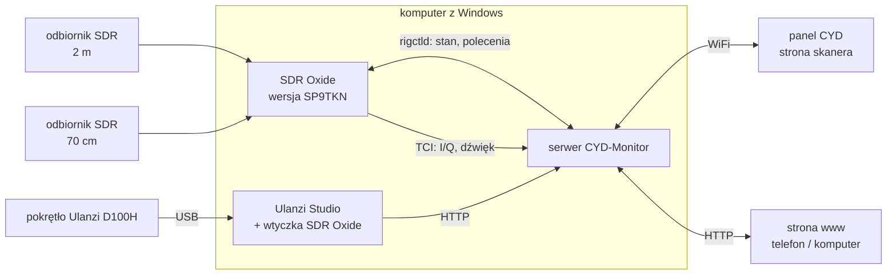

**Jak to działa**

1. **SDR Oxide** prowadzi dwa odbiorniki, *SDR 2M* i *SDR 70CM*; każdy skanuje swoje kanały pamięci. Każde radio ma
   wbudowany serwer Hamlib **rigctld** i serwer **TCI** na localhost. Łatki SP9TKN dodają to, czego potrzebuje zdalny
   skaner: start / stop / następny, przywołanie pamięci, pomijanie kanałów, blokadę szumów i szerokość filtra przez
   rigctld oraz dźwięk po blokadzie szumów przez TCI.
2. **Serwer CYD-Monitor** kilka razy na sekundę pyta rigctld o częstotliwość i poziom. Częstotliwość, która stoi,
   z poziomem ponad blokadą szumów, to transmisja: **panel CYD** przeskakuje z lustra pulpitu na stronę skanera
   (nazwa kanału z pamięci SDR Oxide, częstotliwość, poziom) i wraca sekundę po jej końcu. START, STOP, MUTE i NEXT
   na panelu trafiają z powrotem do SDR Oxide.
3. Ten sam serwer wystawia **stronę www** dla telefonu albo komputera w sieci domowej: oba radia z widmem
   i wodospadem z I/Q przez TCI, lista kanałów, sterowanie skanerem i dźwięk skanera w przeglądarce, także w tle
   na Androidzie.
4. **Pokrętło Ulanzi D100H** każde zdarzenie przycisku i gałki wysyła przez wtyczkę jako zapytanie HTTP do serwera.
   Gdy SDR Oxide jest na wierzchu, gałka stroi wybrane radio, a przyciski wybierają radio, włączają i zatrzymują skan,
   przechodzą po pamięciach i zmieniają szerokość filtra; przy każdym innym oknie te same elementy są klawiszami
   multimediów i głośnością Windows.
5. Panel CYD jest wspólny ze [stacją APRS SP9TKN](https://github.com/SP9TKN/cyd-monitor/blob/main/README.pl.md#część-stacji-aprs-sp9tkn):
   pokazuje jej ekran, dopóki skaner czegoś nie usłyszy.

<!-- ecosystem:sdr:end -->

## Licencja

[GPL-3.0](LICENSE) © 2026 SP9TKN.

**Narzędzia:** program powstał z pomocą [Claude Code](https://claude.com/claude-code) (Anthropic) — asystent AI
do pisania kodu, testów i dokumentacji.
