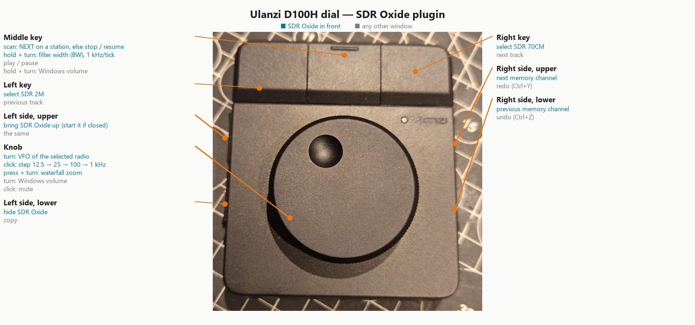
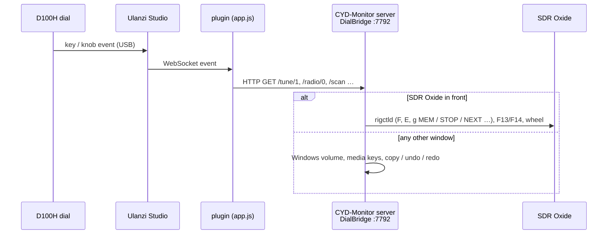
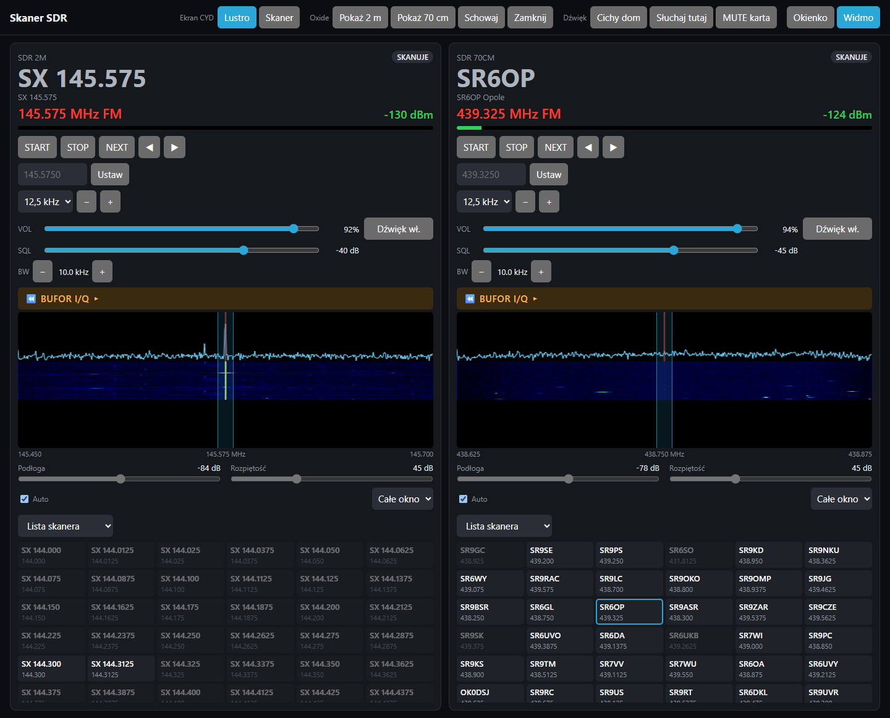
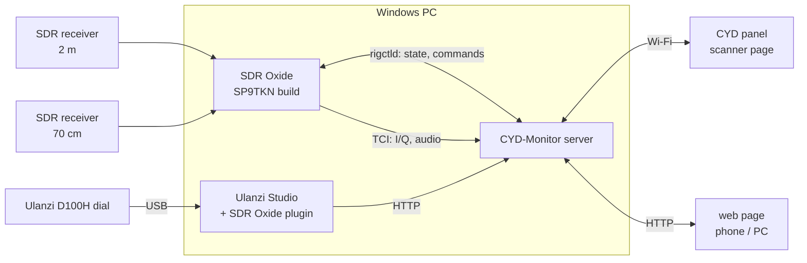

# Ulanzi D100H plugin for SDR Oxide

> 🇵🇱 Polish version: [README.pl.md](README.pl.md)

<!-- ecosystem-link:sdr -->
📻 Part of the **SP9TKN SDR scanner** — see [how the pieces work together](#part-of-the-sp9tkn-sdr-scanner).

An [Ulanzi Studio](https://www.ulanzi.com/) plugin that turns the **Ulanzi D100H dial** into a tuning knob and buttons
for SDR Oxide. It is part of [CYD-Monitor](../README.md): the plugin only forwards the dial's events, and all the logic
lives in the CYD-Monitor server (`server/cyd-monitor/DialBridge.cs`).

  

## How it works

- The plugin decides only two things, because only there do the events still arrive in order: whether a knob press
  was the start of a press-and-turn, and whether the held middle key was turned (then the knob is the filter width).
- The server decides everything else, event by event: it checks whether SDR Oxide is in front and either drives Oxide
  or acts as a normal media dial. One preset serves both, on purpose: Ulanzi Studio 3.4.8 hangs when switching to
  a separate per-application preset.
- The plugin is an HTML main service (no Node.js): Ulanzi's installer stops `node.exe` processes by name.

## Installation

Needs: Ulanzi Studio with autostart, the **CYD-Monitor server** running, and SDR Oxide — the
[SP9TKN build](https://github.com/SP9TKN/sdroxide-brown) for memory recall (`E <number>` in rigctld).

1. Close Ulanzi Studio (it keeps the presets in memory and writes them back on exit).
2. Copy the folder `com.ulanzi.sdroxide.ulanziPlugin` to `%APPDATA%\Ulanzi\UlanziDeck\Plugins`.
3. Put the actions on the dial's preset: `py install-profile.py`. The script starts from the original preset kept in
   `backup/dial-profile-original.json`. **First set `PAGE` in the script to your own dial preset** — the folder names
   under `%APPDATA%\Ulanzi\UlanziDeck\ProfilesV2\…\Profiles\…\manifest.json` are different on every installation.
4. With SDR Oxide closed, bind F13/F14 to the filter width: `py set-oxide-filter-keys.py` (adds two shortcuts to
   Oxide's `input.json`, keeps a dated backup; running it twice changes nothing).
5. Start Ulanzi Studio.

Test without the dial, with the server running: `curl http://127.0.0.1:7792/vol/1`, as well as `/tune/1`, `/hold/1`,
`/filter/1`, `/radio/1`, `/scan`, `/show`, `/hide`, `/press`.

Never show the Studio window with `ShowWindow` from a script: Qt then believes it is hidden and the program hangs.

## Files

| File | What it is |
|---|---|
| `com.ulanzi.sdroxide.ulanziPlugin/manifest.json` | plugin definition: actions for the keys and the knob |
| `com.ulanzi.sdroxide.ulanziPlugin/plugin/app.js` | forwards every event as an HTTP GET to `127.0.0.1:7792` |
| `install-profile.py` | puts the SDR Oxide actions on the dial preset |
| `set-oxide-filter-keys.py` | binds F13/F14 to `FilterWidth` in SDR Oxide |
| `backup/dial-profile-original.json` | the dial preset as Ulanzi Studio ships it |

The full description of every control is in the main README: [Ulanzi D100H dial](../README.md#ulanzi-d100h-dial).

<!-- ecosystem:sdr:start -->

## Part of the SP9TKN SDR scanner

SDR Oxide, CYD-Monitor and an Ulanzi dial work together as one two-band scanner: SDR Oxide listens, the CYD panel and a web page show what it hears, and the dial controls it like the knob of a radio.

| Project | Role |
|---|---|
| [SDR Oxide — SP9TKN build](https://github.com/SP9TKN/sdroxide-brown) | the receiver: two SDRs (2 m and 70 cm) scanning memory channels; the patches add scanner control over rigctld and the audio after squelch over TCI |
| [CYD-Monitor](https://github.com/SP9TKN/cyd-monitor) — server | reads SDR Oxide and drives the panel, the web page and the dial |
| [CYD-Monitor](https://github.com/SP9TKN/cyd-monitor) — panel | ESP32 "Cheap Yellow Display": scanner page with START / STOP / MUTE / NEXT, pops up on a transmission |
| [Ulanzi plugin](https://github.com/SP9TKN/cyd-monitor/tree/main/ulanzi-plugin) **← you are here** | Ulanzi Studio plugin for the D100H dial: tuning, radio select, scan, memories, filter width, zoom |

*The scanner's web page served by the CYD-Monitor server: both SDR Oxide radios with spectrum, waterfall and the channel list.*

**How it works**

1. **SDR Oxide** runs two receivers, *SDR 2M* and *SDR 70CM*, each scanning its own memory channels. Each radio has a
   built-in Hamlib **rigctld** server and a **TCI** server on localhost. The SP9TKN patches add what a remote scanner
   needs: start / stop / next, memory recall, skipping channels, squelch and filter width over rigctld, and the audio
   after squelch over TCI.
2. The **CYD-Monitor server** asks rigctld several times a second for the frequency and the level. A frequency that
   stays put with the level above squelch is a transmission: the **CYD panel** jumps from the desktop mirror to the
   scanner page (channel name from SDR Oxide's memories, frequency, level) and returns a second after it ends.
   START, STOP, MUTE and NEXT on the panel go back to SDR Oxide.
3. The same server serves a **web page** for a phone or a PC on the home network: both radios with spectrum and
   waterfall from the TCI I/Q stream, the channel list, scanner controls and the scanner audio in the browser, also
   in the background on Android.
4. The **Ulanzi D100H dial** sends every button and knob event through the plugin as an HTTP request to the server.
   With SDR Oxide in front, the knob tunes the selected radio and the buttons pick the radio, start and stop the
   scan, step through the memories and change the filter width; with any other window in front, the same controls
   are media keys and the Windows volume.
5. The CYD panel is shared with the [SP9TKN APRS station](https://github.com/SP9TKN/cyd-monitor#part-of-the-sp9tkn-aprs-station):
   it shows the station screen until the scanner hears something.

<!-- ecosystem:sdr:end -->

## License

[GPL-3.0](../LICENSE) © 2026 SP9TKN. Ulanzi and Ulanzi Studio are trademarks of their owner; this plugin is not
affiliated with Ulanzi.

**Tools:** developed with [Claude Code](https://claude.com/claude-code) (Anthropic) — AI assistant used for coding,
testing and documentation.
