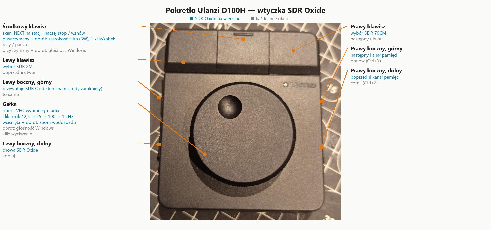
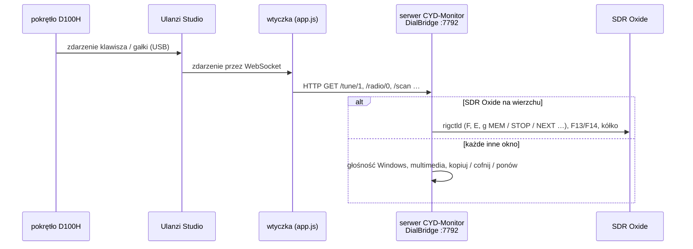
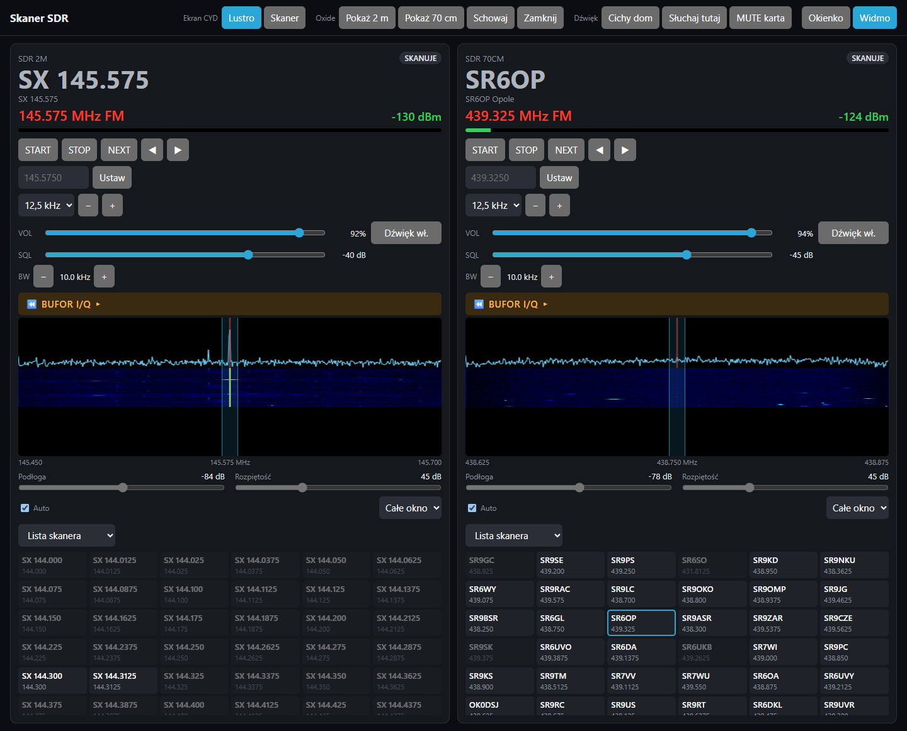
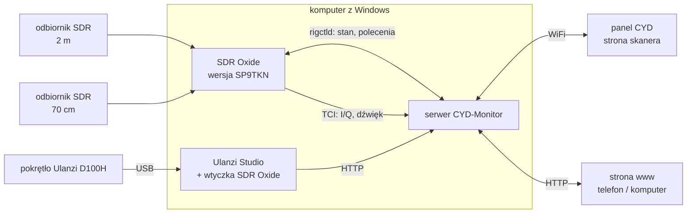

# Wtyczka Ulanzi D100H do SDR Oxide

> 🇬🇧 English version: [README.md](README.md)

<!-- ecosystem-link:sdr -->
📻 Część **skanera SDR SP9TKN** — zobacz, [jak elementy działają razem](#część-skanera-sdr-sp9tkn).

Wtyczka do [Ulanzi Studio](https://www.ulanzi.com/), która robi z **pokrętła Ulanzi D100H** gałkę strojenia i przyciski
SDR Oxide. Jest częścią [CYD-Monitor](../README.pl.md): wtyczka tylko przekazuje zdarzenia pokrętła, a cała logika
siedzi w serwerze CYD-Monitor (`server/cyd-monitor/DialBridge.cs`).

  

## Jak to działa

- Wtyczka rozstrzyga tylko dwie rzeczy, bo tylko u niej zdarzenia idą jeszcze po kolei: czy wciśnięcie gałki było
  początkiem „wciśnij i kręć” oraz czy przytrzymany środkowy klawisz był kręcony (wtedy gałka to szerokość filtra).
- Resztę rozstrzyga serwer, zdarzenie po zdarzeniu: sprawdza, czy SDR Oxide jest na wierzchu, i albo steruje Oxide,
  albo działa jak zwykłe pokrętło multimediów. Jeden preset do obu, celowo: Ulanzi Studio 3.4.8 zawiesza się przy
  przełączaniu na osobny preset dla programu.
- Wtyczka to główna usługa HTML (bez Node.js): instalator Ulanzi zatrzymuje procesy `node.exe` po nazwie.

## Instalacja

Wymaga: Ulanzi Studio z autostartem, działającego **serwera CYD-Monitor** i SDR Oxide —
[wersji SP9TKN](https://github.com/SP9TKN/sdroxide-brown) do przywoływania pamięci (`E <numer>` w rigctld).

1. Zamknij Ulanzi Studio (trzyma presety w pamięci i zapisuje je przy wyjściu).
2. Skopiuj folder `com.ulanzi.sdroxide.ulanziPlugin` do `%APPDATA%\Ulanzi\UlanziDeck\Plugins`.
3. Połóż akcje na presecie pokrętła: `py install-profile.py`. Skrypt wychodzi z oryginalnego presetu zapisanego
   w `backup/dial-profile-original.json`. **Najpierw ustaw w skrypcie `PAGE` na swój preset pokrętła** — nazwy folderów
   w `%APPDATA%\Ulanzi\UlanziDeck\ProfilesV2\…\Profiles\…\manifest.json` są inne w każdej instalacji.
4. Przy zamkniętym SDR Oxide przypisz F13/F14 do szerokości filtra: `py set-oxide-filter-keys.py` (dodaje dwa skróty
   do `input.json` Oxide, robi kopię z datą; drugie uruchomienie niczego nie zmienia).
5. Uruchom Ulanzi Studio.

Test bez pokrętła, przy działającym serwerze: `curl http://127.0.0.1:7792/vol/1`, a także `/tune/1`, `/hold/1`,
`/filter/1`, `/radio/1`, `/scan`, `/show`, `/hide`, `/press`.

Okna Studia nie wolno pokazywać skryptem przez `ShowWindow`: Qt uważa je wtedy za ukryte i program się zawiesza.

## Pliki

| Plik | Co to jest |
|---|---|
| `com.ulanzi.sdroxide.ulanziPlugin/manifest.json` | definicja wtyczki: akcje dla klawiszy i gałki |
| `com.ulanzi.sdroxide.ulanziPlugin/plugin/app.js` | przekazuje każde zdarzenie jako HTTP GET na `127.0.0.1:7792` |
| `install-profile.py` | kładzie akcje SDR Oxide na presecie pokrętła |
| `set-oxide-filter-keys.py` | przypisuje F13/F14 do `FilterWidth` w SDR Oxide |
| `backup/dial-profile-original.json` | preset pokrętła w wersji fabrycznej Ulanzi Studio |

Pełny opis każdego elementu jest w głównym README: [Pokrętło Ulanzi D100H](../README.pl.md#pokrętło-ulanzi-d100h).

<!-- ecosystem:sdr:start -->

## Część skanera SDR SP9TKN

SDR Oxide, CYD-Monitor i pokrętło Ulanzi działają razem jako jeden skaner na dwa pasma: SDR Oxide słucha, panel CYD i strona www pokazują, co słychać, a pokrętło steruje nim jak gałka radia.

| Projekt | Rola |
|---|---|
| [SDR Oxide — wersja SP9TKN](https://github.com/SP9TKN/sdroxide-brown) | odbiornik: dwa SDR-y (2 m i 70 cm) skanujące kanały pamięci; łatki dodają sterowanie skanerem przez rigctld i dźwięk po blokadzie szumów przez TCI |
| [CYD-Monitor](https://github.com/SP9TKN/cyd-monitor) — serwer | czyta SDR Oxide i obsługuje panel, stronę www i pokrętło |
| [CYD-Monitor](https://github.com/SP9TKN/cyd-monitor) — panel | ESP32 „Cheap Yellow Display”: strona skanera z START / STOP / MUTE / NEXT, wyskakuje przy transmisji |
| [Wtyczka Ulanzi](https://github.com/SP9TKN/cyd-monitor/tree/main/ulanzi-plugin) **← tu jesteś** | wtyczka Ulanzi Studio do pokrętła D100H: strojenie, wybór radia, skan, pamięci, szerokość filtra, zoom |

*Strona www skanera wystawiana przez serwer CYD-Monitor: oba radia SDR Oxide z widmem, wodospadem i listą kanałów.*

**Jak to działa**

1. **SDR Oxide** prowadzi dwa odbiorniki, *SDR 2M* i *SDR 70CM*; każdy skanuje swoje kanały pamięci. Każde radio ma
   wbudowany serwer Hamlib **rigctld** i serwer **TCI** na localhost. Łatki SP9TKN dodają to, czego potrzebuje zdalny
   skaner: start / stop / następny, przywołanie pamięci, pomijanie kanałów, blokadę szumów i szerokość filtra przez
   rigctld oraz dźwięk po blokadzie szumów przez TCI.
2. **Serwer CYD-Monitor** kilka razy na sekundę pyta rigctld o częstotliwość i poziom. Częstotliwość, która stoi,
   z poziomem ponad blokadą szumów, to transmisja: **panel CYD** przeskakuje z lustra pulpitu na stronę skanera
   (nazwa kanału z pamięci SDR Oxide, częstotliwość, poziom) i wraca sekundę po jej końcu. START, STOP, MUTE i NEXT
   na panelu trafiają z powrotem do SDR Oxide.
3. Ten sam serwer wystawia **stronę www** dla telefonu albo komputera w sieci domowej: oba radia z widmem
   i wodospadem z I/Q przez TCI, lista kanałów, sterowanie skanerem i dźwięk skanera w przeglądarce, także w tle
   na Androidzie.
4. **Pokrętło Ulanzi D100H** każde zdarzenie przycisku i gałki wysyła przez wtyczkę jako zapytanie HTTP do serwera.
   Gdy SDR Oxide jest na wierzchu, gałka stroi wybrane radio, a przyciski wybierają radio, włączają i zatrzymują skan,
   przechodzą po pamięciach i zmieniają szerokość filtra; przy każdym innym oknie te same elementy są klawiszami
   multimediów i głośnością Windows.
5. Panel CYD jest wspólny ze [stacją APRS SP9TKN](https://github.com/SP9TKN/cyd-monitor/blob/main/README.pl.md#część-stacji-aprs-sp9tkn):
   pokazuje jej ekran, dopóki skaner czegoś nie usłyszy.

<!-- ecosystem:sdr:end -->

## Licencja

[GPL-3.0](../LICENSE) © 2026 SP9TKN. Ulanzi i Ulanzi Studio to znaki towarowe ich właściciela; ta wtyczka nie jest
związana z firmą Ulanzi.

**Narzędzia:** program powstał z pomocą [Claude Code](https://claude.com/claude-code) (Anthropic) — asystent AI
do pisania kodu, testów i dokumentacji.
